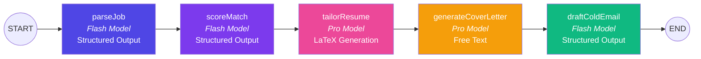
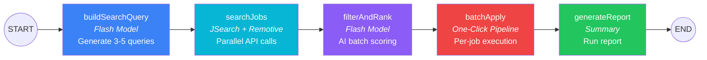
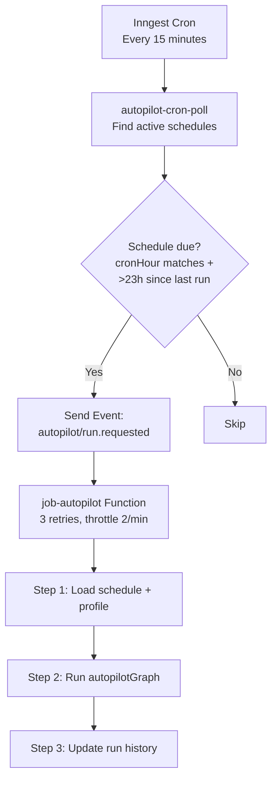
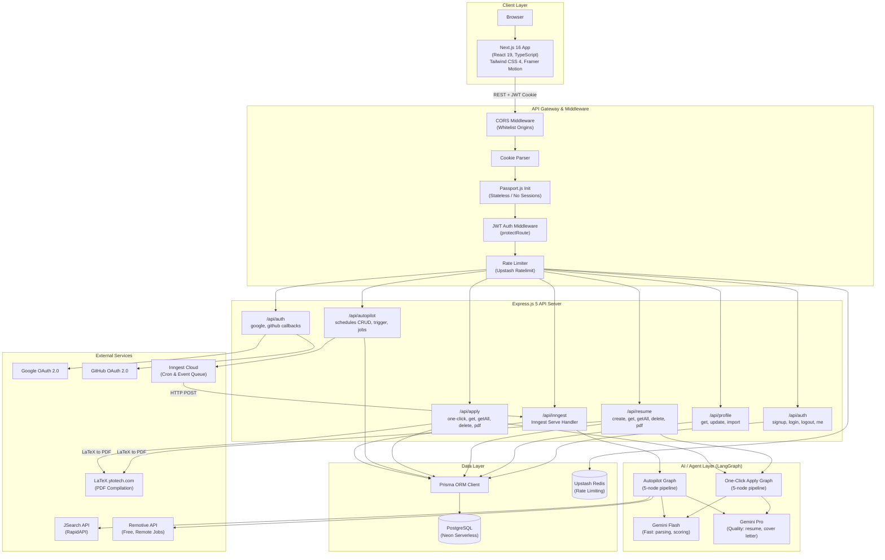
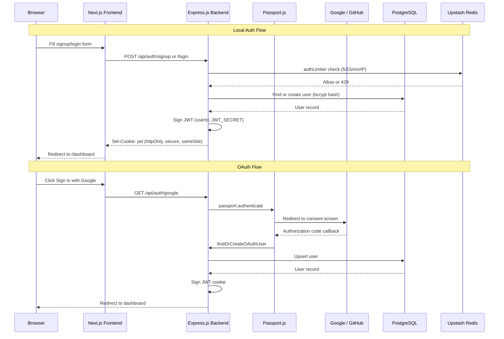
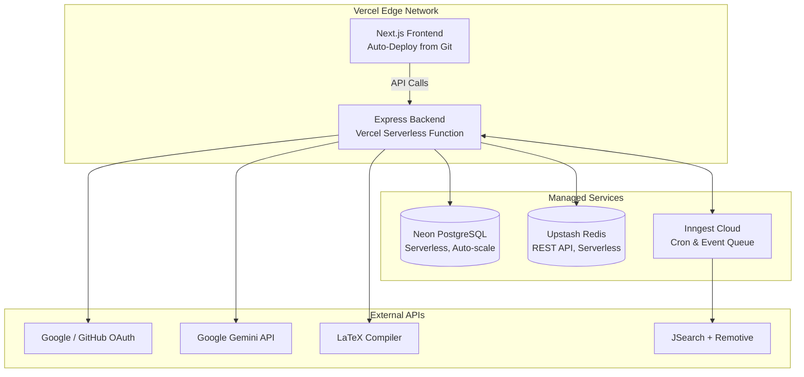

# Product Requirements Document (PRD)

## AI CareerCrew AI — Intelligent Career Automation Suite

| Field | Detail |
|-------|--------|
| **Product Name** | AI CareerCrew AI |
| **Author** | Ayush Kumar Ray |
| **Version** | 1.0.0 |
| **Date** | June 22, 2026 |
| **Status** | Released (v1.0) |
| **Repository** | [AyushRay06/Resume-Generator](https://github.com/AyushRay06/Resume-Generator) |
| **Live URL** | [resumeai.ayushray.in](https://resumeai.ayushray.in) |
| **License** | MIT |

---

## Table of Contents

1. [Product Vision & Objectives](#1-product-vision--objectives)
2. [Target Audience & User Personas](#2-target-audience--user-personas)
3. [Problem Statement](#3-problem-statement)
4. [Scope & Boundaries](#4-scope--boundaries)
5. [Functional Requirements](#5-functional-requirements)
6. [Non-Functional Requirements](#6-non-functional-requirements)
7. [System Architecture](#7-system-architecture)
8. [Technology Stack](#8-technology-stack)
9. [Data Model & Entity Relationships](#9-data-model--entity-relationships)
10. [API Contract Specification](#10-api-contract-specification)
11. [User Stories & Acceptance Criteria](#11-user-stories--acceptance-criteria)
12. [UI/UX Requirements](#12-uiux-requirements)
13. [Security & Compliance](#13-security--compliance)
14. [Rate Limiting & Abuse Prevention](#14-rate-limiting--abuse-prevention)
15. [Deployment & Infrastructure](#15-deployment--infrastructure)
16. [Performance Benchmarks](#16-performance-benchmarks)
17. [Known Limitations](#17-known-limitations)
18. [Future Roadmap](#18-future-roadmap)
19. [Glossary](#19-glossary)

---

## 1. Product Vision & Objectives

### 1.1 Vision Statement

> Eliminate the repetitive, time-consuming process of tailoring resumes, cover letters, and outreach emails for every job application — by building an intelligent AI agent that does it in one click, or autonomously on a schedule.

### 1.2 Primary Objectives

| # | Objective | Measure of Success |
|---|-----------|-------------------|
| O1 | **Automate resume tailoring** — Generate ATS-compliant LaTeX resumes uniquely customized to each job description | Resume generated in < 60s with correct LaTeX compilation |
| O2 | **Implement multi-step AI agents** — Decompose the application workflow into composable, validated pipeline steps using LangGraph | 5-node DAG pipeline with Zod-validated structured outputs at every node |
| O3 | **Enable autonomous job discovery & application** — Build a fully autonomous Job Autopilot that discovers, scores, and prepares applications without manual intervention | Up to 5 tailored applications per scheduled run cycle |
| O4 | **Centralize profile management** — Store career data once, reuse across all pipelines | One-click profile import from any existing resume |
| O5 | **Deliver production-grade infrastructure** — JWT + OAuth 2.0 auth, Redis rate limiting, serverless deployment | Zero-downtime deployment on Vercel with < 200ms API p95 latency |

### 1.3 Success Metrics (KPIs)

| Metric | Target |
|--------|--------|
| Time-to-tailored-resume | < 60 seconds |
| One-Click Apply pipeline completion | < 90 seconds (all 5 outputs) |
| Autopilot jobs discovered per run | 15–30 listings |
| Autopilot applications prepared per run | Up to 5 (configurable) |
| PDF compilation success rate | > 95% |
| System uptime | > 99.5% |

---

## 2. Target Audience & User Personas

### Persona 1: Active Job Seeker — "Priya"

| Attribute | Detail |
|-----------|--------|
| **Role** | Final-year CS student / recent graduate |
| **Goal** | Apply to 10+ jobs per week with tailored materials |
| **Pain Point** | Spends 45 min per application customizing resume and writing cover letters |
| **Usage Pattern** | Uses One-Click Apply 3–5 times/week; activates Autopilot during peak hiring seasons |
| **Value Proposition** | Reduces per-application effort from 45 minutes to < 2 minutes |

### Persona 2: Passive Job Hunter — "Rohit"

| Attribute | Detail |
|-----------|--------|
| **Role** | Mid-level software engineer, currently employed |
| **Goal** | Stay aware of matching opportunities without active daily effort |
| **Pain Point** | Doesn't have time to search job boards daily; misses good postings |
| **Usage Pattern** | Sets up Autopilot with daily cron schedule; reviews discovered jobs weekly |
| **Value Proposition** | Zero-effort job monitoring with AI-scored match quality |

### Persona 3: Career Switcher — "Ananya"

| Attribute | Detail |
|-----------|--------|
| **Role** | Professional transitioning from one domain to another |
| **Goal** | Reframe existing experience to match new target roles |
| **Pain Point** | Struggles to highlight transferable skills for unfamiliar job descriptions |
| **Usage Pattern** | Relies heavily on AI resume tailoring to reposition experience; uses match score to gauge readiness |
| **Value Proposition** | AI identifies transferable skills and highlights them against job requirements |

---

## 3. Problem Statement

### 3.1 The Problem

The modern job market demands hyper-tailored application materials for every role. A generic resume sent to 50 companies yields significantly lower response rates than 50 individually tailored resumes. However:

- **Manual tailoring takes ~45 minutes per job** (resume customization + cover letter + outreach email)
- **Job discovery is fragmented** across LinkedIn, Indeed, Glassdoor, and company sites
- **ATS (Applicant Tracking Systems) reject 75% of resumes** before a human ever reads them — often due to missing keywords
- **No existing tool combines** AI resume generation, job-specific tailoring, cover letter writing, cold email drafting, AND autonomous job discovery in a single platform

### 3.2 Competitive Landscape

| Product | Resume Generation | AI Tailoring | Cover Letter | Cold Email | Autonomous Job Discovery |
|---------|:-:|:-:|:-:|:-:|:-:|
| **Overleaf** | ✅ (manual LaTeX) | ❌ | ❌ | ❌ | ❌ |
| **Resumake** | ✅ | ❌ | ❌ | ❌ | ❌ |
| **Kickresume** | ✅ | Partial | ✅ | ❌ | ❌ |
| **Teal** | ✅ | ✅ | ✅ | ❌ | ❌ |
| **AI CareerCrew AI** | ✅ | ✅ | ✅ | ✅ | ✅ |

> [!IMPORTANT]
> **Key Differentiator:** AI CareerCrew AI is the only platform that combines AI-powered resume tailoring with autonomous job discovery and batch application preparation — all running on configurable cron schedules without user intervention.

---

## 4. Scope & Boundaries

### 4.1 In Scope (v1.0)

- [x] AI-powered LaTeX resume generation tailored to specific job descriptions
- [x] 5-node One-Click Apply pipeline (parse → score → resume → cover letter → cold email)
- [x] 5-node Job Autopilot pipeline with multi-source job discovery (JSearch + Remotive)
- [x] Master Profile system with one-click resume import
- [x] Authentication: email/password (bcrypt + JWT) and OAuth 2.0 (Google, GitHub)
- [x] Redis-based distributed rate limiting (sliding window)
- [x] LaTeX → PDF compilation via external API
- [x] Background job scheduling via Inngest (cron poller + event-driven execution)
- [x] Responsive dashboard with dark/light mode, animations, and glassmorphism
- [x] Vercel serverless deployment with Neon PostgreSQL

### 4.2 Out of Scope (v1.0)

- ❌ Direct job application submission (auto-apply to company portals)
- ❌ Email notification system for autopilot results
- ❌ Real-time WebSocket/SSE streaming of pipeline progress
- ❌ Multiple LaTeX template selection
- ❌ LinkedIn profile import
- ❌ Payment/subscription system (Stripe)
- ❌ Interview preparation features
- ❌ Multi-language resume generation
- ❌ Mobile native app

---

## 5. Functional Requirements

### FR-1: User Authentication & Account Management

| ID | Requirement | Priority |
|----|-------------|----------|
| FR-1.1 | Users can register with email and password | P0 |
| FR-1.2 | Users can log in with email and password | P0 |
| FR-1.3 | Users can log in via Google OAuth 2.0 | P0 |
| FR-1.4 | Users can log in via GitHub OAuth 2.0 | P0 |
| FR-1.5 | OAuth users are created on first login (find-or-create pattern) | P0 |
| FR-1.6 | JWT tokens are stored in HttpOnly, Secure, SameSite cookies (7-day expiry) | P0 |
| FR-1.7 | Users can log out (clears JWT cookie) | P0 |
| FR-1.8 | Users can update their display name | P1 |
| FR-1.9 | Protected routes reject requests without valid JWT | P0 |

---

### FR-2: AI Resume Generation

| ID | Requirement | Priority |
|----|-------------|----------|
| FR-2.1 | Users can submit personal details (name, contact, skills, experience, projects, education, achievements) via a multi-section form | P0 |
| FR-2.2 | Users must provide a target job description | P0 |
| FR-2.3 | System generates a complete ATS-optimized LaTeX resume using Google Gemini AI | P0 |
| FR-2.4 | Generated LaTeX follows a standardized professional template with proper section ordering | P0 |
| FR-2.5 | LaTeX special characters (%, &, #, _, $) are auto-escaped | P0 |
| FR-2.6 | Resume content is uniquely tailored to the provided job description (keyword matching, skill emphasis, experience rephrasing) | P0 |
| FR-2.7 | Failed AI calls are retried with exponential backoff | P1 |
| FR-2.8 | Users can view all their previously generated resumes | P0 |
| FR-2.9 | Users can delete individual resumes | P1 |
| FR-2.10 | Users can compile any resume's LaTeX code to a downloadable PDF | P0 |
| FR-2.11 | Resume creation is rate-limited to 2 per 24 hours per user | P0 |

---

### FR-3: One-Click Apply Pipeline

| ID | Requirement | Priority |
|----|-------------|----------|
| FR-3.1 | Users can submit a job description and trigger the full 5-node pipeline with one click | P0 |
| FR-3.2 | **Node 1 — parseJob**: Extracts job title, company, required skills, keywords, and responsibilities into structured JSON (Zod-validated `ParsedJobSchema`) | P0 |
| FR-3.3 | **Node 2 — scoreMatch**: Computes a 0–100 match score with strengths, gaps, and actionable suggestions (Zod-validated `MatchResultSchema`) | P0 |
| FR-3.4 | **Node 3 — tailorResume**: Generates a full ATS-optimized LaTeX resume tailored to the parsed job using the professional template | P0 |
| FR-3.5 | **Node 4 — generateCoverLetter**: Writes a 300–400 word personalized cover letter | P0 |
| FR-3.6 | **Node 5 — draftColdEmail**: Drafts a cold outreach email with subject line and body (Zod-validated `ColdEmailSchema`) | P0 |
| FR-3.7 | Pipeline executes asynchronously — HTTP response returns immediately with Application ID | P0 |
| FR-3.8 | All pipeline outputs are persisted in the Application record | P0 |
| FR-3.9 | Users can view all past applications with their outputs | P0 |
| FR-3.10 | Users can compile any application's tailored resume to PDF | P0 |
| FR-3.11 | Users can delete applications | P1 |
| FR-3.12 | Pipeline requires a Master Profile to be configured | P0 |

#### Pipeline Architecture



---

### FR-4: Job Autopilot

| ID | Requirement | Priority |
|----|-------------|----------|
| FR-4.1 | Users can create named autopilot schedules with configurable parameters | P0 |
| FR-4.2 | Schedule parameters include: target roles (array), locations (array), work type (remote/onsite/hybrid/any), experience level, salary range, post age, min match score, max applications per run | P0 |
| FR-4.3 | Users can set a cron expression and timezone for each schedule | P0 |
| FR-4.4 | Users can activate/deactivate schedules via toggle | P0 |
| FR-4.5 | Users can update schedule filters and configuration | P1 |
| FR-4.6 | Users can delete schedules (cascades to discovered jobs) | P1 |
| FR-4.7 | **Node 1 — buildSearchQuery**: AI generates 3–5 optimized search query strings from user profile + schedule filters | P0 |
| FR-4.8 | **Node 2 — searchJobs**: Parallel API calls to JSearch (RapidAPI) and Remotive, with deduplication by title + company | P0 |
| FR-4.9 | **Node 3 — filterAndRank**: AI batch-scores each job (groups of 10) against user profile; saves all discovered jobs to DB; filters by `minMatchScore`; caps at `maxApplications` | P0 |
| FR-4.10 | **Node 4 — batchApply**: Sequentially invokes the One-Click Apply pipeline for each qualified job with 5s throttle between runs | P0 |
| FR-4.11 | **Node 5 — generateReport**: Produces a human-readable summary of the run (jobs found, qualified, applied, top matches) | P0 |
| FR-4.12 | Schedule execution history is tracked (lastRunAt, lastRunStatus, totalRuns, totalApplied) | P0 |
| FR-4.13 | Users can manually trigger a schedule run (via Inngest event or direct in-process execution) | P0 |
| FR-4.14 | Users can browse all discovered jobs with match scores and status filters | P1 |
| FR-4.15 | Users can delete discovered jobs | P2 |

#### Autopilot Pipeline Architecture



#### Background Scheduling (Inngest)



| Inngest Function | Trigger | Retries | Throttle | Purpose |
|------------------|---------|---------|----------|---------|
| `job-autopilot` | Event: `autopilot/run.requested` | 3 | 2/min | Runs the full autopilot LangGraph pipeline |
| `autopilot-cron-poll` | Cron: `*/15 * * * *` | 1 | — | Polls all active schedules and triggers due ones |

---

### FR-5: Master Profile System

| ID | Requirement | Priority |
|----|-------------|----------|
| FR-5.1 | Users can create and update a single Master Profile containing all career data | P0 |
| FR-5.2 | Profile fields: fullName, email, phone, github, linkedin, portfolio, skills (array), experience (array of objects), projects (array of objects), education (array of objects), achievements (array of objects) | P0 |
| FR-5.3 | Users can one-click import profile data from any existing resume | P1 |
| FR-5.4 | Master Profile is used as input for both One-Click Apply and Job Autopilot pipelines | P0 |
| FR-5.5 | Profile uses upsert pattern (create if not exists, update otherwise) | P1 |

---

### FR-6: PDF Compilation

| ID | Requirement | Priority |
|----|-------------|----------|
| FR-6.1 | System compiles LaTeX source code into PDF via external API (latex.ytotech.com) | P0 |
| FR-6.2 | PDF binary response is validated (checks for `%PDF` signature) | P1 |
| FR-6.3 | Compiled PDFs are streamed directly to the client for download | P0 |
| FR-6.4 | PDF compilation works for both standalone resumes and application-generated resumes | P0 |

---

## 6. Non-Functional Requirements

### NFR-1: Performance

| Requirement | Target |
|-------------|--------|
| API response time (simple CRUD) | < 200ms (p95) |
| AI Resume generation (single) | < 30 seconds |
| One-Click Apply pipeline (all 5 nodes) | < 90 seconds |
| Autopilot full run (5 applications) | < 10 minutes |
| PDF compilation | < 10 seconds |
| Frontend initial page load (LCP) | < 2.5 seconds |

### NFR-2: Scalability

| Requirement | Target |
|-------------|--------|
| Concurrent users | 100+ simultaneous |
| Database connections | Serverless pool (Neon auto-scaling) |
| Background job concurrency | 2 concurrent Inngest runs per minute |
| Rate limiting capacity | Redis-backed sliding window, scales horizontally |

### NFR-3: Availability & Reliability

| Requirement | Target |
|-------------|--------|
| System uptime | > 99.5% |
| Rate limiter failure mode | Fail-open (allow requests if Redis is unreachable) |
| AI pipeline retry policy | Exponential backoff, up to 3 retries |
| Inngest function retry | 3 retries with configurable backoff |
| Data durability | PostgreSQL with Neon auto-backups |

### NFR-4: Security

| Requirement | Implementation |
|-------------|---------------|
| Password storage | bcryptjs with 10 salt rounds |
| Token storage | JWT in HttpOnly, Secure, SameSite cookies |
| CORS | Whitelist-based origin validation |
| SQL injection | Prisma ORM parameterized queries |
| OAuth CSRF | Passport.js state parameter handling |
| Input validation | Zod schemas for all AI outputs + manual endpoint validation |
| API key protection | Server-side only; never exposed to client |

### NFR-5: Maintainability

| Requirement | Implementation |
|-------------|---------------|
| Code organization | MVC pattern (routes → controllers → models/agents) |
| Database migrations | Prisma Migrate with version-controlled schema |
| AI pipeline composability | LangGraph StateGraph with independent, testable nodes |
| Environment management | dotenv with `.env.example` template |
| Containerization | Dockerfile (Node 18 Alpine) for self-hosted deployment |

---

## 7. System Architecture

### 7.1 High-Level Architecture Diagram



### 7.2 Key Architectural Decisions

| Decision | Rationale |
|----------|-----------|
| **Stateless JWT Auth** | No server-side sessions needed; JWT in HttpOnly cookies. Passport.js used only for OAuth handshake, not session management |
| **LangGraph DAG Pipelines** | Each pipeline node is a pure function operating on shared state — testable, composable, and debuggable. State is managed via LangGraph `Annotation` |
| **Single Cron Poller** | Instead of dynamic per-user crons, a single Inngest cron runs every 15 min and checks which schedules are due. Avoids complexity of managing per-user cron registrations |
| **Dual Job Sources** | JSearch (RapidAPI) aggregates Google Jobs, LinkedIn, Indeed, Glassdoor. Remotive supplements with remote-only positions. Deduplication by `title + company` |
| **Fail-Open Rate Limiting** | If Upstash Redis is unreachable, requests are allowed through. Availability is prioritized over strictness |
| **External LaTeX Compilation** | PDF compilation offloaded to `latex.ytotech.com` to avoid needing a local TeX installation on serverless infrastructure |

---

## 8. Technology Stack

### 8.1 Frontend

| Category | Technology | Version | Purpose |
|----------|-----------|---------|---------|
| Framework | Next.js | 16.1.6 | React-based full-stack framework with App Router |
| UI Library | React | 19.1.0 | Component-based UI rendering |
| Language | TypeScript | 5.x | Type-safe JavaScript |
| Styling | Tailwind CSS | 4.x | Utility-first CSS framework |
| Animations | Framer Motion | 12.31.0 | Production-grade motion library |
| Component Library | Radix UI | 1.5.0 | Accessible headless UI primitives |
| Icons | Lucide React | 0.544.0 | Icon system |
| Theming | next-themes | 0.4.6 | Dark/light mode support |
| HTTP Client | Axios | 1.12.2 | API communication |
| Notifications | React Hot Toast | 2.6.0 | Toast notifications |
| Font | Plus Jakarta Sans | — | Google Font via `next/font` |

### 8.2 Backend

| Category | Technology | Version | Purpose |
|----------|-----------|---------|---------|
| Runtime | Node.js | 18+ | JavaScript runtime |
| Framework | Express.js | 5.1.0 | HTTP server and routing |
| Database ORM | Prisma | 6.16.1 | Type-safe database access |
| Database | PostgreSQL (Neon) | — | Primary relational database |
| AI SDK | OpenAI SDK | 5.20.2 | LLM API calls (configured for Gemini) |
| AI Orchestration | LangChain + LangGraph | Latest | Multi-step AI agent pipelines |
| Background Jobs | Inngest | 4.4.0 | Serverless background function execution |
| Rate Limiting | Upstash Redis + Ratelimit | 2.0.8 | Distributed rate limiting |
| Authentication | JWT + bcryptjs | — | Token-based auth with password hashing |
| OAuth | Passport.js | 0.7.0 | Google & GitHub OAuth 2.0 |
| Validation | Zod | 4.4.3 | Runtime schema validation for AI outputs |

### 8.3 AI Models

| Model | Provider | Temperature | Usage |
|-------|----------|-------------|-------|
| `gemini-2.0-flash` | Google DeepMind | 0.3 | Fast tasks — job parsing, match scoring, cold email drafting |
| `gemini-2.5-pro` | Google DeepMind | 0.4 | Quality tasks — resume tailoring, cover letter generation |
| `gemini-3-flash-preview` | Google DeepMind | 0.7 | Direct resume generation (non-pipeline) |

### 8.4 External APIs

| API | Provider | Purpose | Cost |
|-----|----------|---------|------|
| LaTeX.ytotech.com | YtoTech | LaTeX → PDF compilation | Free |
| JSearch | RapidAPI | Job search aggregation (Google Jobs, LinkedIn, Indeed, Glassdoor) | Free tier: 200 req/mo |
| Remotive | Remotive.com | Remote job listings | Free (no key required) |
| Google OAuth 2.0 | Google Cloud | Social authentication | Free |
| GitHub OAuth 2.0 | GitHub | Social authentication | Free |

---

## 9. Data Model & Entity Relationships

### 9.1 ER Diagram

```mermaid
erDiagram
    User ||--o{ Resume : "has many"
    User ||--o| UserProfile : "has one"
    User ||--o{ Application : "has many"
    User ||--o{ JobSchedule : "has many"
    JobSchedule ||--o{ DiscoveredJob : "discovers"
    Application ||--o| DiscoveredJob : "sourced from"

    User {
        String id PK "cuid()"
        String fullName
        String email UK
        String password "nullable (OAuth users)"
        String provider "local | google | github"
        String providerId "nullable"
        String avatar "nullable"
        String subscriptionPlan "free | pro | elite"
        DateTime createdAt
        DateTime updatedAt
    }

    Resume {
        String id PK "cuid()"
        String title "default: My Resume"
        String fullName
        String phone "nullable"
        String email
        String github "nullable"
        String linkedin "nullable"
        String portfolio "nullable"
        Json skills
        Json experience "nullable"
        Json projects
        Json education
        Json achievements "nullable"
        Text jobDescription
        Text latexCode "nullable"
        String userId FK
        DateTime createdAt
        DateTime updatedAt
    }

    UserProfile {
        String id PK "cuid()"
        String fullName
        String email
        String phone "nullable"
        String github "nullable"
        String linkedin "nullable"
        String portfolio "nullable"
        Json skills
        Json experience "nullable"
        Json projects
        Json education
        Json achievements "nullable"
        String userId FK_UK "unique"
        DateTime createdAt
        DateTime updatedAt
    }

    Application {
        String id PK "cuid()"
        Text jobDescription
        Json parsedJob "nullable"
        Float matchScore "nullable"
        Json matchAnalysis "nullable"
        Text tailoredResume "nullable (LaTeX)"
        Text coverLetter "nullable"
        Json coldEmail "nullable"
        String status "processing | completed | failed"
        String userId FK
        DateTime createdAt
        DateTime updatedAt
    }

    JobSchedule {
        String id PK "cuid()"
        String name "default: My Job Search"
        Boolean isActive "default: true"
        String cronExpression
        String timezone "default: Asia/Kolkata"
        Json targetRoles
        Json locations
        String workType "default: any"
        String experienceLevel "default: any"
        Int salaryMin "nullable"
        Int salaryMax "nullable"
        String postAge "default: 24h"
        Int minMatchScore "default: 60"
        Int maxApplications "default: 5"
        DateTime lastRunAt "nullable"
        String lastRunStatus "nullable"
        Int totalRuns "default: 0"
        Int totalApplied "default: 0"
        String userId FK
        DateTime createdAt
        DateTime updatedAt
    }

    DiscoveredJob {
        String id PK "cuid()"
        String title
        String company
        String location "nullable"
        String salary "nullable"
        String url "nullable"
        String source "jsearch | remotive"
        DateTime postedAt "nullable"
        Text description
        Float matchScore "nullable"
        Text matchReason "nullable"
        String status "default: discovered"
        String applicationId FK_UK "nullable, unique"
        String scheduleId FK
        DateTime createdAt
    }
```

### 9.2 Relationship Summary

| Relationship | Type | On Delete | Description |
|---|---|---|---|
| User → Resume | One-to-Many | Cascade | A user owns multiple resumes |
| User → UserProfile | One-to-One | Cascade | A user has one master profile |
| User → Application | One-to-Many | Cascade | A user creates multiple applications |
| User → JobSchedule | One-to-Many | Cascade | A user configures multiple autopilot schedules |
| JobSchedule → DiscoveredJob | One-to-Many | Cascade | A schedule discovers multiple jobs |
| Application ↔ DiscoveredJob | One-to-One (optional) | — | A discovered job may link to the application it generated |

### 9.3 Status Lifecycles

**Application.status:**
```
processing → completed | failed
```

**DiscoveredJob.status:**
```
discovered → qualified → applied | skipped | below_threshold
```

**JobSchedule.lastRunStatus:**
```
success | partial | failed | no_matches
```

---

## 10. API Contract Specification

### 10.1 Authentication — `/api/auth`

| Method | Endpoint | Auth | Rate Limit | Request Body | Response |
|--------|----------|------|------------|-------------|----------|
| `POST` | `/api/auth/signup` | Public | 5/15min (IP) | `{ fullName, email, password }` | `201 { user }` + Set-Cookie |
| `POST` | `/api/auth/login` | Public | 5/15min (IP) | `{ email, password }` | `200 { user }` + Set-Cookie |
| `POST` | `/api/auth/logout` | Public | — | — | `200 { message }` + Clear-Cookie |
| `GET` | `/api/auth/me` | JWT | — | — | `200 { user }` |
| `PUT` | `/api/auth/update-profile` | JWT | — | `{ fullName }` | `200 { user }` |
| `GET` | `/api/auth/google` | Public | — | — | `302` → Google consent |
| `GET` | `/api/auth/google/callback` | Public | — | — | `302` → Dashboard + Set-Cookie |
| `GET` | `/api/auth/github` | Public | — | — | `302` → GitHub consent |
| `GET` | `/api/auth/github/callback` | Public | — | — | `302` → Dashboard + Set-Cookie |

### 10.2 Resume — `/api/resume`

| Method | Endpoint | Auth | Rate Limit | Request Body | Response |
|--------|----------|------|------------|-------------|----------|
| `POST` | `/api/resume` | JWT | 2/24h (user) | `{ title, fullName, email, phone?, github?, linkedin?, portfolio?, skills, experience?, projects, education, achievements?, jobDescription }` | `201 { resume }` |
| `GET` | `/api/resume/all` | JWT | — | — | `200 [{ resume }]` |
| `GET` | `/api/resume/:id` | JWT | — | — | `200 { resume }` |
| `GET` | `/api/resume/:id/compile` | JWT | — | — | `200 application/pdf` (binary stream) |
| `DELETE` | `/api/resume/:id` | JWT | — | — | `200 { message }` |

### 10.3 Profile — `/api/profile`

| Method | Endpoint | Auth | Request Body | Response |
|--------|----------|------|-------------|----------|
| `GET` | `/api/profile` | JWT | — | `200 { profile }` or `404` |
| `POST` | `/api/profile` | JWT | `{ fullName, email, phone?, github?, linkedin?, portfolio?, skills, experience?, projects, education, achievements? }` | `200 { profile }` (upsert) |
| `POST` | `/api/profile/import/:resumeId` | JWT | — | `200 { profile }` |

### 10.4 One-Click Apply — `/api/apply`

| Method | Endpoint | Auth | Request Body | Response |
|--------|----------|------|-------------|----------|
| `POST` | `/api/apply` | JWT | `{ jobDescription }` | `200 { application }` (status: processing, async pipeline starts) |
| `GET` | `/api/apply` | JWT | — | `200 [{ application }]` |
| `GET` | `/api/apply/:id` | JWT | — | `200 { application }` (includes all pipeline outputs) |
| `GET` | `/api/apply/:id/compile` | JWT | — | `200 application/pdf` |
| `DELETE` | `/api/apply/:id` | JWT | — | `200 { message }` |

### 10.5 Autopilot — `/api/autopilot`

| Method | Endpoint | Auth | Request Body | Response |
|--------|----------|------|-------------|----------|
| `POST` | `/api/autopilot/schedules` | JWT | `{ name?, cronExpression, timezone?, targetRoles, locations, workType?, experienceLevel?, salaryMin?, salaryMax?, postAge?, minMatchScore?, maxApplications? }` | `201 { schedule }` |
| `GET` | `/api/autopilot/schedules` | JWT | — | `200 [{ schedule }]` |
| `GET` | `/api/autopilot/schedules/:id` | JWT | — | `200 { schedule, recentJobs }` |
| `PUT` | `/api/autopilot/schedules/:id` | JWT | `{ ...updatedFields }` | `200 { schedule }` |
| `PATCH` | `/api/autopilot/schedules/:id/toggle` | JWT | — | `200 { schedule }` |
| `DELETE` | `/api/autopilot/schedules/:id` | JWT | — | `200 { message }` |
| `POST` | `/api/autopilot/schedules/:id/run` | JWT | — | `200 { message, eventId }` (via Inngest) |
| `POST` | `/api/autopilot/schedules/:id/run-direct` | JWT | — | `200 { result }` (bypass Inngest, in-process) |
| `GET` | `/api/autopilot/jobs` | JWT | Query: `?scheduleId=&status=&page=&limit=` | `200 { jobs, total, page }` |
| `DELETE` | `/api/autopilot/jobs/:id` | JWT | — | `200 { message }` |

**Total Endpoints: 28**

---

## 11. User Stories & Acceptance Criteria

### Epic 1: Authentication

#### US-1.1: Email Registration
> **As a** new user, **I want to** sign up with my email and password, **so that** I can create an account and start using the platform.

**Acceptance Criteria:**
- [x] User provides fullName, email, and password
- [x] Password is hashed with bcrypt (10 salt rounds) before storage
- [x] Duplicate email returns `400` error
- [x] JWT cookie is set on successful registration
- [x] User is redirected to `/dashboard`

#### US-1.2: OAuth Login
> **As a** returning user, **I want to** sign in with my Google or GitHub account, **so that** I can access the platform without remembering a password.

**Acceptance Criteria:**
- [x] Clicking "Sign in with Google/GitHub" redirects to the OAuth consent screen
- [x] On first login, a new user account is created with provider info and avatar
- [x] On subsequent logins, the existing account is found and authenticated
- [x] JWT cookie is set after successful OAuth callback
- [x] User is redirected to `/dashboard`

---

### Epic 2: Resume Generation

#### US-2.1: Create AI Resume
> **As a** job seeker, **I want to** submit my details and a job description, **so that** the AI generates a tailored, ATS-friendly LaTeX resume for me.

**Acceptance Criteria:**
- [x] Multi-section form collects all personal and career data
- [x] Job description is required
- [x] AI generates a complete LaTeX resume within 30 seconds
- [x] LaTeX special characters are properly escaped
- [x] Resume is saved to the database
- [x] Rate limit of 2 per 24 hours is enforced

#### US-2.2: Download Resume PDF
> **As a** user, **I want to** download my generated resume as a PDF, **so that** I can attach it to job applications.

**Acceptance Criteria:**
- [x] Clicking "Download PDF" triggers LaTeX → PDF compilation
- [x] PDF is compiled via external API and streamed to browser
- [x] Invalid LaTeX returns a meaningful error message
- [x] PDF opens correctly in standard viewers

---

### Epic 3: One-Click Apply

#### US-3.1: Run One-Click Apply
> **As a** job seeker, **I want to** paste a job description and receive a tailored resume, cover letter, and cold email in one click, **so that** I can apply faster.

**Acceptance Criteria:**
- [x] User has a Master Profile configured (prerequisite)
- [x] Submitting triggers the 5-node pipeline asynchronously
- [x] HTTP response returns immediately with the Application ID
- [x] All 5 outputs (parsed job, match score, resume, cover letter, cold email) are generated
- [x] Match score includes strengths, gaps, and suggestions
- [x] Results are viewable in the application detail page

---

### Epic 4: Job Autopilot

#### US-4.1: Configure Autopilot Schedule
> **As a** job seeker, **I want to** set up an automated job search schedule, **so that** the system finds and prepares applications for matching jobs while I sleep.

**Acceptance Criteria:**
- [x] User can specify target roles, locations, work type, experience level, salary range
- [x] User can set a cron schedule with timezone
- [x] User can configure min match score and max applications per run
- [x] Schedule can be toggled active/inactive
- [x] Schedule appears in the autopilot dashboard

#### US-4.2: Review Autopilot Results
> **As a** user, **I want to** review all jobs discovered by the autopilot, **so that** I can see which ones matched and what materials were prepared.

**Acceptance Criteria:**
- [x] Discovered jobs are listed with match scores and status
- [x] Jobs can be filtered by status (discovered, qualified, applied, skipped)
- [x] Applied jobs link to their full Application record
- [x] Run history shows summary reports

---

### Epic 5: Profile Management

#### US-5.1: Create Master Profile
> **As a** user, **I want to** store my career data once, **so that** I don't have to re-enter it for every application.

**Acceptance Criteria:**
- [x] Profile editor has sections for skills, experience, projects, education, achievements
- [x] Data is saved with upsert (create or update)
- [x] Profile data is used automatically by One-Click Apply and Autopilot pipelines

#### US-5.2: Import from Resume
> **As a** user who has already created a resume, **I want to** import that data into my Master Profile, **so that** I don't have to re-enter everything manually.

**Acceptance Criteria:**
- [x] One-click import populates all profile fields from an existing resume record
- [x] Imported data can be edited after import

---

## 12. UI/UX Requirements

### 12.1 Design System

| Element | Specification |
|---------|--------------|
| **Theme** | Dark mode (default) + Light mode via system preference detection |
| **Font** | Plus Jakarta Sans (Google Fonts) |
| **Colors** | HSL-based palette with dark-mode-first design |
| **Component Library** | Radix UI primitives (headless, accessible) |
| **Animations** | Framer Motion for transitions, hover effects, loading states |
| **Icons** | Lucide React + Tabler Icons |
| **Layout** | Sidebar-based dashboard with collapsible navigation |
| **Responsive** | Mobile-first with custom hooks (`use-mobile`, `use-media-query`) |

### 12.2 Key UI Effects

| Effect | Implementation |
|--------|---------------|
| Glassmorphism | Backdrop filters on cards and overlays |
| 3D Globe | Three.js / React Three Fiber on landing page hero |
| Infinite Logo Slider | Embla Carousel for company logos |
| Rainbow Button | Animated gradient CTA button |
| Animated Beams | Custom animated beam visualization component |
| Skeleton Loading | Custom skeleton components for async data |
| Vertical Cut Reveal | Text animation component |

### 12.3 Page Map

| Page | Route | Description |
|------|-------|-------------|
| Landing | `/` | Hero, features, how-it-works, testimonials, pricing, footer |
| Login | `/login` | Email/password + OAuth buttons |
| Signup | `/signup` | Registration form + OAuth buttons |
| Dashboard | `/dashboard` | Overview stats, recent resumes, quick actions |
| Resume Builder | `/resume` | Multi-section form with real-time preview |
| One-Click Apply | `/apply` | JD input → pipeline results |
| **Autopilot** | `/autopilot` | Schedule CRUD, filter config, run trigger, progress overlay |
| Profile | `/profile` | Master profile editor |
| Jobs | `/jobs` | Discovered jobs browser with match scores |
| Saved Resumes | `/saved-resumes` | Resume history with delete/view |
| Billing | `/billing` | Pricing and plan management |

---

## 13. Security & Compliance

### 13.1 Authentication Flow



### 13.2 Security Checklist

| # | Control | Status |
|---|---------|--------|
| 1 | Passwords hashed with bcrypt (10 salt rounds) | ✅ |
| 2 | JWT in HttpOnly cookies (prevents XSS token theft) | ✅ |
| 3 | Secure + SameSite cookie flags | ✅ |
| 4 | CORS whitelist (not wildcard) | ✅ |
| 5 | Rate limiting on auth endpoints (5/15min/IP) | ✅ |
| 6 | Rate limiting on resume creation (2/24h/user) | ✅ |
| 7 | Prisma ORM parameterized queries (SQL injection prevention) | ✅ |
| 8 | API keys stored server-side only | ✅ |
| 9 | Zod validation on all AI outputs | ✅ |
| 10 | OAuth CSRF protection via Passport.js | ✅ |

---

## 14. Rate Limiting & Abuse Prevention

| Limiter | Scope | Window | Limit | Strategy | On Failure |
|---------|-------|--------|-------|----------|------------|
| `authLimiter` | Per IP address | 15 minutes | 5 requests | Sliding window (Upstash) | Fail-open |
| `resumeCreationLimiter` | Per user ID | 24 hours | 2 requests | Sliding window (Upstash) | Fail-open |

**Fail-Open Rationale:** If Upstash Redis is unreachable (network partition, outage), requests are allowed through rather than blocking all users. Availability is prioritized over abuse prevention for short outage windows.

---

## 15. Deployment & Infrastructure

### 15.1 Production Architecture



### 15.2 Environment Variables

| Variable | Service | Purpose |
|----------|---------|---------|
| `DATABASE_URL` | Neon | PostgreSQL connection string |
| `JWT_SECRET` | Internal | JWT signing secret |
| `GEMINI_API_KEY` | Google | AI model access |
| `UPSTASH_REDIS_REST_URL` | Upstash | Redis endpoint |
| `UPSTASH_REDIS_REST_TOKEN` | Upstash | Redis auth token |
| `GOOGLE_CLIENT_ID` | Google Cloud | OAuth client ID |
| `GOOGLE_CLIENT_SECRET` | Google Cloud | OAuth client secret |
| `GITHUB_CLIENT_ID` | GitHub | OAuth app client ID |
| `GITHUB_CLIENT_SECRET` | GitHub | OAuth app client secret |
| `CLIENT_URL` | Internal | Frontend URL for OAuth redirects |
| `RAPIDAPI_KEY` | RapidAPI | JSearch API key |
| `INNGEST_EVENT_KEY` | Inngest | Event sending key |
| `INNGEST_SIGNING_KEY` | Inngest | Request verification key |

### 15.3 Deployment Options

| Component | Primary | Alternative |
|-----------|---------|-------------|
| Frontend | Vercel (auto-deploy from Git) | Any Next.js-compatible host |
| Backend | Vercel Serverless (`@vercel/node`) | Docker container (Node 18 Alpine) |
| Database | Neon PostgreSQL (serverless) | Any PostgreSQL provider |
| Redis | Upstash (serverless REST) | Any Redis provider |
| Background Jobs | Inngest Cloud | Self-hosted Inngest |

---

## 16. Performance Benchmarks

| Operation | Measured Performance |
|-----------|---------------------|
| Single resume generation (AI + save) | < 30 seconds |
| Full One-Click Apply pipeline (5 nodes) | < 90 seconds |
| PDF compilation | 3–8 seconds |
| Autopilot full run (discover → apply for 5 jobs) | 5–10 minutes |
| Dashboard page load | < 2 seconds |
| API latency (CRUD operations) | < 200ms (p95) |

---

## 17. Known Limitations

| # | Limitation | Impact | Severity |
|---|-----------|--------|----------|
| 1 | LaTeX compilation depends on external API (latex.ytotech.com) | Single point of failure for PDF generation | High |
| 2 | JSearch API free-tier limit of 200 requests/month | Limits autopilot job search frequency for free users | Medium |
| 3 | No real-time WebSocket/SSE updates for pipeline progress | Users must poll/refresh to see results | Medium |
| 4 | Resume creation rate limit is 2 per 24 hours | Restricts power users on the free tier | Low |
| 5 | Autopilot cron accuracy is ±15 minutes | Based on polling interval, not exact cron matching | Low |
| 6 | No email notification system | Users aren't notified when autopilot finds matches | Medium |
| 7 | Single LaTeX template | No design variety for resumes | Low |
| 8 | No direct job application submission | Users still need to manually submit to company portals | Medium |

---

## 18. Future Roadmap

### Phase 2: Engagement & Notifications (High Priority)

| Feature | Description | Effort |
|---------|-------------|--------|
| **Real-time Pipeline Streaming** | WebSocket/SSE integration for live pipeline progress updates | 2–3 days |
| **Email Notifications** | Send email alerts when autopilot discovers high-match jobs | 1–2 days |
| **Stripe Integration** | Paid tiers (Pro, Elite) with higher rate limits and autopilot frequency | 3–4 days |

### Phase 3: Content & Templates (Medium Priority)

| Feature | Description | Effort |
|---------|-------------|--------|
| **Multiple Resume Templates** | User-selectable LaTeX template designs | 2–3 days |
| **LinkedIn Profile Import** | Import career data directly from LinkedIn | 2–3 days |
| **ATS Score Checker** | Upload existing resume and get ATS compatibility score | 1–2 days |
| **Self-hosted LaTeX** | Docker-based pdflatex compilation to eliminate external dependency | 2 days |

### Phase 4: Intelligence & Analytics (Lower Priority)

| Feature | Description | Effort |
|---------|-------------|--------|
| **Interview Prep Agent** | AI-generated interview questions based on job description | 3–4 days |
| **Analytics Dashboard** | Track application success rates, response rates, score trends | 3–4 days |
| **Multi-language Support** | Resume generation in languages other than English | 2–3 days |

---

## 19. Glossary

| Term | Definition |
|------|-----------|
| **ATS** | Applicant Tracking System — software used by employers to filter resumes before human review |
| **CUID** | Collision-resistant Unique Identifier — used as primary keys in the database |
| **DAG** | Directed Acyclic Graph — the computational model used by LangGraph pipelines |
| **JD** | Job Description — the text describing a job posting's requirements |
| **JWT** | JSON Web Token — a compact, URL-safe means of representing claims between parties |
| **LaTeX** | A document preparation system used for high-quality typesetting |
| **LangGraph** | A LangChain framework for building stateful, multi-step AI agent workflows as graphs |
| **LLM** | Large Language Model — the AI model powering resume generation and job analysis |
| **OAuth 2.0** | An authorization framework that enables third-party login (Google, GitHub) |
| **Pipeline Node** | A single step in a LangGraph pipeline that processes and transforms state |
| **Structured Output** | LLM responses that conform to a predefined Zod schema (JSON structure) |
| **Upsert** | A database operation that creates a record if it doesn't exist, or updates it if it does |

---

> *This PRD was generated on June 22, 2026 and reflects the state of AI CareerCrew AI v1.0.0.*
