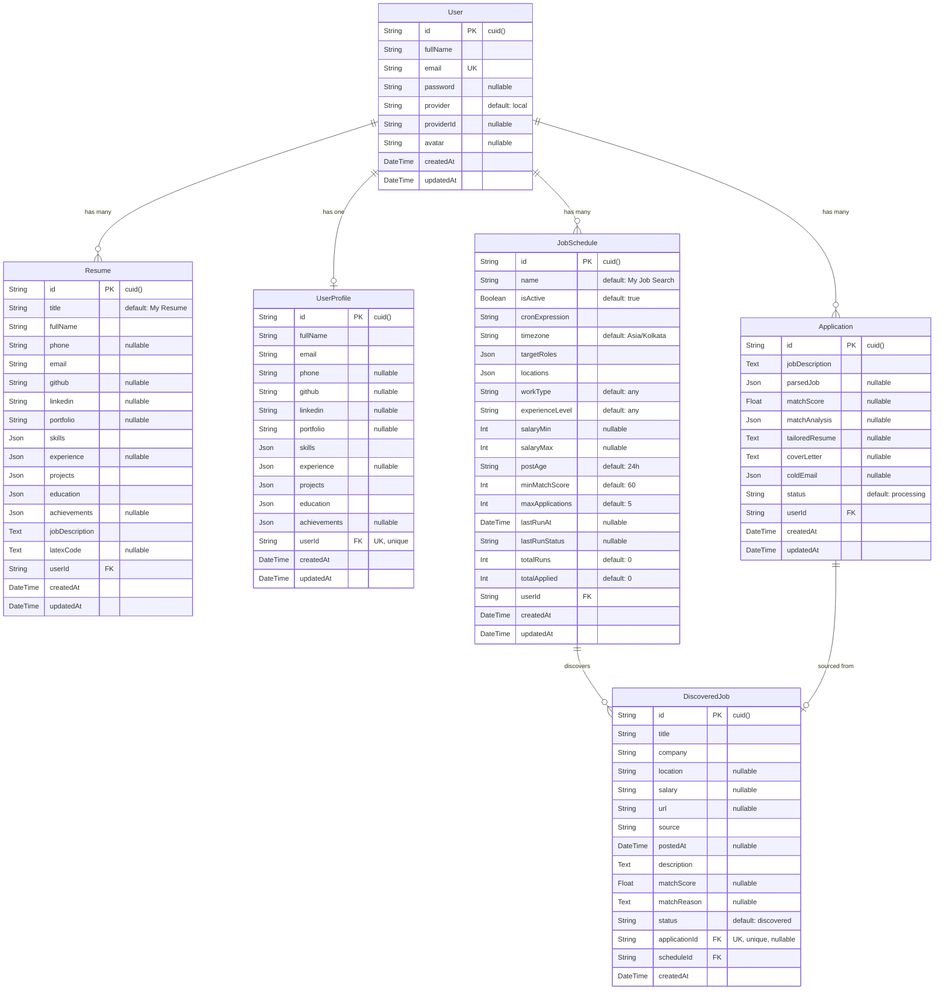

# ER Diagram — CareerCrew AI

## Relationship Summary

| Relationship | Type | On Delete | Description |
|---|---|---|---|
| **User → Resume** | One-to-Many | Cascade | A user owns multiple resumes |
| **User → UserProfile** | One-to-One | Cascade | A user has one master profile |
| **User → Application** | One-to-Many | Cascade | A user creates multiple applications |
| **User → JobSchedule** | One-to-Many | Cascade | A user configures multiple autopilot schedules |
| **JobSchedule → DiscoveredJob** | One-to-Many | Cascade | A schedule discovers multiple jobs |
| **Application → DiscoveredJob** | One-to-One (optional) | — | A discovered job may link to the application it generated |

## Status Lifecycles

**Application.status:**
`processing` → `completed` | `failed`

**DiscoveredJob.status:**
`discovered` → `qualified` → `applied` | `skipped` | `below_threshold`

**JobSchedule.lastRunStatus:**
`success` | `partial` | `failed` | `no_matches`
