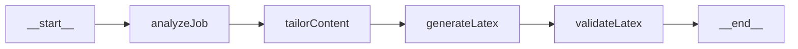
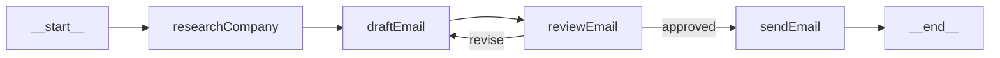
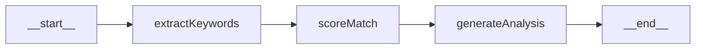
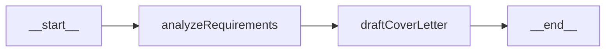
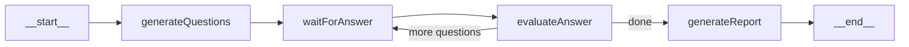

# CareerForge AI — Full Career Platform

Transform the existing Resume-Agent into a complete AI-powered career platform using **LangChain.js** and **LangGraph.js** for all AI workflows.

## Current State

| Layer | Stack | Key Files |
|-------|-------|-----------|
| Frontend | Next.js 16, React 19, Tailwind v4, Framer Motion | [page.tsx](file:///Users/ayushkumarray/100xAyush/Projects/Resume-Agent/frontend/src/app/resume/page.tsx), [dashboard](file:///Users/ayushkumarray/100xAyush/Projects/Resume-Agent/frontend/src/app/dashboard/page.tsx) |
| Backend | Express 5, Prisma, OpenAI SDK (Gemini via proxy) | [resume.controller.js](file:///Users/ayushkumarray/100xAyush/Projects/Resume-Agent/backend/src/controller/resume.controller.js) |
| Database | PostgreSQL + Prisma | [schema.prisma](file:///Users/ayushkumarray/100xAyush/Projects/Resume-Agent/backend/prisma/schema.prisma) |
| AI | Raw OpenAI SDK calls, no agentic workflow | Single `chat.completions.create` call |

---

## User Review Required

> [!IMPORTANT]
> **Major Architecture Change**: The AI layer will be completely rewritten from raw OpenAI SDK calls to LangChain + LangGraph. The existing resume generation flow will be refactored to use the new agent architecture while keeping the same external API contract (your frontend won't break).

> [!WARNING]
> **New Dependencies**: This adds ~8 new npm packages to the backend. The `openai` package will be replaced by `@langchain/google` + `@langchain/core` + `@langchain/langgraph`. Ensure your Node.js version is **20.x or 22.x**.

> [!IMPORTANT]
> **Email Sending (Phase 2)**: You'll need SMTP credentials. Gmail with App Passwords works for development, but you should use a service like **Resend**, **SendGrid**, or **AWS SES** for production. Which do you prefer?

> [!IMPORTANT]
> **Job Data Source (Phase 3)**: There are no free official APIs from LinkedIn/Indeed. Options:
> - **SerpAPI** (Google Jobs) — ~$50/mo, easiest to integrate
> - **RapidAPI job aggregators** — Pay-per-request, varying quality  
> - **Public ATS feeds** (Greenhouse, Lever, Ashby) — Free but limited to companies using those platforms
> - **Manual paste** — User pastes job URLs/descriptions (no cost, simplest)
>
> Which approach do you want to start with?

## Open Questions

1. **Model preference**: You're currently using `gemini-3-flash-preview`. Do you want to stick with Gemini for all agents, or use different models for different tasks (e.g., Gemini Flash for speed, Gemini Pro for quality)?

2. **Email provider**: Gmail App Password for dev, but what for production? (Resend / SendGrid / AWS SES / other)

3. **User profile storage**: Should we create a separate `UserProfile` model that stores the user's "master" resume data (skills, experience, etc.) so they don't re-enter it every time? This would power all agents.

4. **Phase priority**: I've ordered the phases by dependency, but which feature excites you most? I can reorder based on your priority.

---

## Proposed Changes

### Phase 1 — Foundation: LangChain + LangGraph Migration

Replace the raw OpenAI SDK with LangChain.js and introduce LangGraph.js as the agent orchestration layer.

#### New Backend Dependencies

```bash
npm install @langchain/core @langchain/google @langchain/langgraph zod nodemailer
npm install -D @types/nodemailer  # if you add TS later
```

| Package | Version | Purpose |
|---------|---------|---------|
| `@langchain/core` | latest | Base abstractions (messages, tools, prompts) |
| `@langchain/google` | latest | Gemini integration via `ChatGoogle` class |
| `@langchain/langgraph` | latest | Graph-based agent orchestration |
| `zod` | latest | Schema validation for tool inputs + structured output |
| `nodemailer` | latest | Email sending (Phase 2) |

---

#### [NEW] `backend/src/agents/llm.js` — Shared LLM Configuration

Central LLM factory using the new `@langchain/google` package (replaces the OpenAI SDK proxy approach).

```javascript
import { ChatGoogle } from "@langchain/google";

// Fast model for simple tasks (email drafts, scoring)
export const flashModel = new ChatGoogle({
  model: "gemini-2.0-flash",
  apiKey: process.env.GEMINI_API_KEY,
});

// Pro model for complex reasoning (resume generation, interview prep)
export const proModel = new ChatGoogle({
  model: "gemini-2.5-pro-preview-05-06",
  apiKey: process.env.GEMINI_API_KEY,
});
```

---

#### [NEW] `backend/src/agents/resume/graph.js` — CareerCrew AI as a LangGraph

Refactor the existing resume generation into a proper LangGraph workflow with separate nodes:



**Nodes:**
1. **analyzeJob** — Extracts key skills, requirements, and keywords from the job description
2. **tailorContent** — Rewrites user's experience/projects/skills to match the JD
3. **generateLatex** — Fills the LaTeX template with tailored content
4. **validateLatex** — Post-processes and validates LaTeX (escaping special chars, etc.)

---

#### [MODIFY] [resume.controller.js](file:///Users/ayushkumarray/100xAyush/Projects/Resume-Agent/backend/src/controller/resume.controller.js)

Replace the monolithic `createResume` function's AI call with the new LangGraph invocation:

```diff
-import OpenAI from "openai";
+import { resumeGraph } from "../agents/resume/graph.js";

// In createResume():
-const response = await retryWithBackoff(async () => {
-  return ai.chat.completions.create({ ... });
-});
-let latexCode = response.choices[0].message.content;
+const result = await resumeGraph.invoke({
+  userDetails: { fullName, phone, email, ... },
+  jobDescription,
+  template: loadLatexTemplate(),
+});
+let latexCode = result.latexCode;
```

---

#### [NEW] `backend/src/agents/tools/` — Shared Tool Directory

```
backend/src/agents/tools/
├── webSearch.js      # Web search tool (for company research)
├── emailSender.js    # Nodemailer-wrapped tool
└── jobSearch.js      # Job API integration tool
```

---

### Phase 2 — Cold Email Agent

#### [MODIFY] [schema.prisma](file:///Users/ayushkumarray/100xAyush/Projects/Resume-Agent/backend/prisma/schema.prisma)

Add email-related models:

```prisma
model EmailCampaign {
  id          String   @id @default(cuid())
  name        String
  status      String   @default("draft") // draft, active, completed
  
  userId      String
  user        User     @relation(fields: [userId], references: [id], onDelete: Cascade)
  
  emails      Email[]
  
  createdAt   DateTime @default(now())
  updatedAt   DateTime @updatedAt
  @@map("email_campaigns")
}

model Email {
  id              String   @id @default(cuid())
  recipientEmail  String
  recipientName   String?
  companyName     String?
  role            String?
  subject         String
  body            String   @db.Text
  status          String   @default("draft") // draft, sent, failed
  sentAt          DateTime?
  
  campaignId      String
  campaign        EmailCampaign @relation(fields: [campaignId], references: [id], onDelete: Cascade)
  
  createdAt       DateTime @default(now())
  updatedAt       DateTime @updatedAt
  @@map("emails")
}
```

#### [NEW] `backend/src/agents/coldEmail/graph.js` — Cold Email LangGraph



**Nodes:**
1. **researchCompany** — Uses a web search tool to gather context about the target company
2. **draftEmail** — Generates a personalized cold email based on user profile + company research + target role
3. **reviewEmail** — AI self-reviews the email for tone, length, and personalization quality
4. **sendEmail** — Sends via nodemailer (with human-in-the-loop approval from frontend)

#### [NEW] `backend/src/agents/tools/emailSender.js`

```javascript
import { tool } from "@langchain/core/tools";
import { z } from "zod";
import nodemailer from "nodemailer";

const transporter = nodemailer.createTransport({
  host: process.env.SMTP_HOST,
  port: parseInt(process.env.SMTP_PORT || "587"),
  secure: false,
  auth: {
    user: process.env.SMTP_USER,
    pass: process.env.SMTP_PASS,
  },
});

export const sendEmailTool = tool(
  async ({ to, subject, body }) => {
    const info = await transporter.sendMail({
      from: `"${process.env.SMTP_FROM_NAME}" <${process.env.SMTP_USER}>`,
      to, subject, html: body,
    });
    return `Email sent! ID: ${info.messageId}`;
  },
  {
    name: "send_email",
    description: "Send an email to a recipient",
    schema: z.object({
      to: z.string().email(),
      subject: z.string(),
      body: z.string(),
    }),
  }
);
```

#### [NEW] `backend/src/controller/email.controller.js`
#### [NEW] `backend/src/routes/email.route.js`

New API endpoints:
- `POST /api/email/generate` — Generate cold email draft
- `POST /api/email/send` — Send an approved email
- `GET /api/email/campaigns` — List user's email campaigns
- `GET /api/email/campaigns/:id` — Get campaign details with emails

---

### Phase 3 — Job Matching Agent

#### [MODIFY] [schema.prisma](file:///Users/ayushkumarray/100xAyush/Projects/Resume-Agent/backend/prisma/schema.prisma)

```prisma
model SavedJob {
  id              String   @id @default(cuid())
  title           String
  company         String
  location        String?
  description     String   @db.Text
  url             String?
  source          String?  // "serpapi", "manual", "greenhouse"
  matchScore      Float?   // 0-100 AI-computed match score
  matchAnalysis   String?  @db.Text // JSON with detailed breakdown
  status          String   @default("saved") // saved, applied, interviewing, rejected, offer
  
  userId          String
  user            User     @relation(fields: [userId], references: [id], onDelete: Cascade)
  
  createdAt       DateTime @default(now())
  updatedAt       DateTime @updatedAt
  @@map("saved_jobs")
}

model UserProfile {
  id              String   @id @default(cuid())
  
  // Master profile data (reusable across features)
  fullName        String
  email           String
  phone           String?
  github          String?
  linkedin        String?
  portfolio       String?
  summary         String?  @db.Text
  skills          Json     // categorized skills
  experience      Json?
  projects        Json
  education       Json
  achievements    Json?
  
  userId          String   @unique
  user            User     @relation(fields: [userId], references: [id], onDelete: Cascade)
  
  createdAt       DateTime @default(now())
  updatedAt       DateTime @updatedAt
  @@map("user_profiles")
}
```

#### [NEW] `backend/src/agents/jobMatch/graph.js` — Job Match LangGraph



**Nodes:**
1. **extractKeywords** — Extracts required skills, experience level, and key requirements from JD
2. **scoreMatch** — Compares user profile against extracted requirements, produces 0-100 score
3. **generateAnalysis** — Generates human-readable analysis: strengths, gaps, suggestions for improvement

#### [NEW] `backend/src/controller/job.controller.js`
#### [NEW] `backend/src/routes/job.route.js`

New API endpoints:
- `POST /api/jobs/analyze` — Analyze a job description against user profile
- `POST /api/jobs/save` — Save a job listing
- `GET /api/jobs/saved` — Get all saved jobs
- `PATCH /api/jobs/:id/status` — Update application status
- `DELETE /api/jobs/:id` — Remove a saved job

---

### Phase 4 — Cover Letter Agent

#### [NEW] `backend/src/agents/coverLetter/graph.js`



Uses the user's profile + job description + (optionally) a matching resume to generate a tailored cover letter.

#### [NEW] `backend/src/controller/coverLetter.controller.js`
#### [NEW] `backend/src/routes/coverLetter.route.js`

- `POST /api/cover-letter/generate` — Generate cover letter
- `GET /api/cover-letter/:id` — Get a saved cover letter

---

### Phase 5 — Interview Prep Agent

#### [MODIFY] [schema.prisma](file:///Users/ayushkumarray/100xAyush/Projects/Resume-Agent/backend/prisma/schema.prisma)

```prisma
model InterviewSession {
  id              String   @id @default(cuid())
  jobTitle        String
  company         String?
  jobDescription  String?  @db.Text
  type            String   // "behavioral", "technical", "system-design"
  
  questions       InterviewQuestion[]
  
  userId          String
  user            User     @relation(fields: [userId], references: [id], onDelete: Cascade)
  
  createdAt       DateTime @default(now())
  updatedAt       DateTime @updatedAt
  @@map("interview_sessions")
}

model InterviewQuestion {
  id              String   @id @default(cuid())
  question        String   @db.Text
  userAnswer      String?  @db.Text
  aiFeedback      String?  @db.Text
  score           Float?
  
  sessionId       String
  session         InterviewSession @relation(fields: [sessionId], references: [id], onDelete: Cascade)
  
  createdAt       DateTime @default(now())
  @@map("interview_questions")
}
```

#### [NEW] `backend/src/agents/interview/graph.js` — Interview Prep LangGraph



#### [NEW] `backend/src/controller/interview.controller.js`
#### [NEW] `backend/src/routes/interview.route.js`

- `POST /api/interview/start` — Start a mock interview session
- `POST /api/interview/:sessionId/answer` — Submit an answer, get feedback
- `GET /api/interview/:sessionId/report` — Get full session report

---

### Phase 6 — Frontend Expansion

#### New Pages

| Route | Purpose |
|-------|---------|
| `/dashboard` | **Enhanced** — Hub with stats, recent activity, quick actions |
| `/profile` | **[NEW]** — Master profile editor (powers all agents) |
| `/email` | **[NEW]** — Cold email generator + campaign tracker |
| `/jobs` | **[NEW]** — Job board with match scoring + application tracker |
| `/cover-letter` | **[NEW]** — Cover letter generator |
| `/interview` | **[NEW]** — Mock interview simulator |

#### New Components

```
frontend/src/components/
├── email/
│   ├── EmailComposer.tsx        # AI email generation form
│   ├── EmailPreview.tsx         # Preview + approve/edit before sending
│   └── CampaignTracker.tsx      # List of campaigns + stats
├── jobs/
│   ├── JobAnalyzer.tsx          # Paste JD → get match score
│   ├── JobCard.tsx              # Individual job listing card
│   └── ApplicationTracker.tsx   # Kanban-style status tracker
├── interview/
│   ├── InterviewChat.tsx        # Chat-like Q&A interface
│   └── InterviewReport.tsx      # Score + feedback summary
├── profile/
│   └── ProfileEditor.tsx        # Master profile form
└── shared/
    ├── AgentProgress.tsx         # Shows LangGraph agent progress
    └── MarkdownRenderer.tsx      # Render AI-generated content
```

---

## Proposed File Structure (After All Phases)

```
backend/src/
├── agents/                      # [NEW] All LangGraph agents
│   ├── llm.js                   # Shared LLM configuration
│   ├── resume/
│   │   └── graph.js             # Resume generation graph
│   ├── coldEmail/
│   │   └── graph.js             # Cold email graph
│   ├── jobMatch/
│   │   └── graph.js             # Job matching graph
│   ├── coverLetter/
│   │   └── graph.js             # Cover letter graph
│   ├── interview/
│   │   └── graph.js             # Interview prep graph
│   └── tools/                   # Shared tools
│       ├── webSearch.js
│       ├── emailSender.js
│       └── jobSearch.js
├── controller/
│   ├── auth.controller.js       # Existing
│   ├── compile.controller.js    # Existing
│   ├── resume.controller.js     # [MODIFY] Use LangGraph
│   ├── email.controller.js      # [NEW]
│   ├── job.controller.js        # [NEW]
│   ├── coverLetter.controller.js # [NEW]
│   ├── interview.controller.js  # [NEW]
│   └── profile.controller.js    # [NEW]
├── routes/
│   ├── auth.route.js            # Existing
│   ├── resume.route.js          # Existing
│   ├── email.route.js           # [NEW]
│   ├── job.route.js             # [NEW]
│   ├── coverLetter.route.js     # [NEW]
│   ├── interview.route.js       # [NEW]
│   └── profile.route.js         # [NEW]
├── lib/                         # Existing
├── middleware/                   # Existing
├── templates/                   # Existing
└── index.js                     # [MODIFY] Register new routes
```

---

## Execution Order

| Phase | Feature | Estimated Effort | Dependencies |
|-------|---------|-----------------|--------------|
| **1** | LangChain/LangGraph Foundation + Resume Migration | ~2-3 hours | None |
| **2** | Cold Email Agent (generate + send) | ~2-3 hours | Phase 1 |
| **3** | Job Matching Agent | ~2-3 hours | Phase 1 |
| **4** | Cover Letter Agent | ~1-2 hours | Phase 1 |
| **5** | Interview Prep Agent | ~2-3 hours | Phase 1 |
| **6** | Frontend Expansion (all new pages) | ~4-6 hours | Phases 1-5 |

> [!TIP]
> I recommend we build **Phase 1 first** (the foundation), then you can pick which feature (Phase 2-5) to build next based on your priority. Phase 6 (frontend) can be done incrementally alongside each backend phase.

---

## Verification Plan

### Automated Tests

For each phase:
```bash
# 1. Ensure backend builds without errors
cd backend && node --check src/index.js

# 2. Run Prisma migrations
npx prisma db push

# 3. Test each API endpoint with curl
curl -X POST http://localhost:5000/api/resume/create \
  -H "Content-Type: application/json" \
  -H "Cookie: jwt=<token>" \
  -d '{ ... }'
```

### Manual Verification

- **Phase 1**: Generate a resume using the new LangGraph pipeline → compare output quality with the old approach
- **Phase 2**: Generate a cold email → preview it → send to a test email address
- **Phase 3**: Paste a job description → verify match score and analysis quality
- **Phase 4**: Generate a cover letter → verify it references the correct JD and user details
- **Phase 5**: Start a mock interview → answer questions → verify feedback quality
- **Phase 6**: Navigate all new frontend pages → verify responsive layout and interactions
