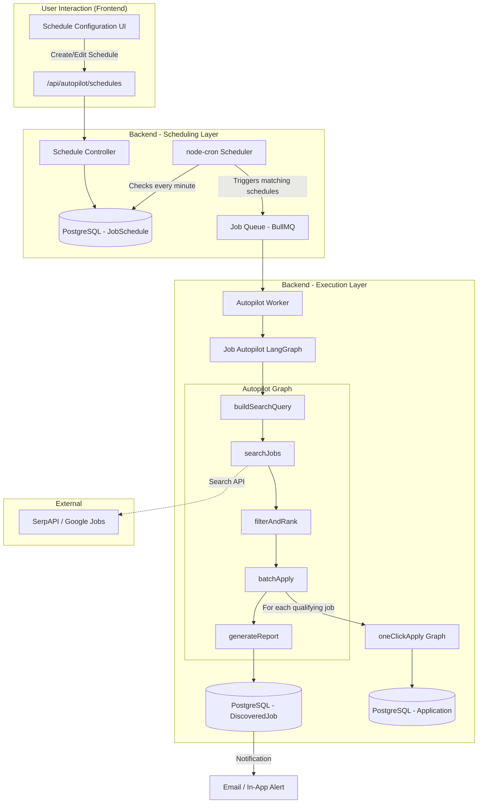
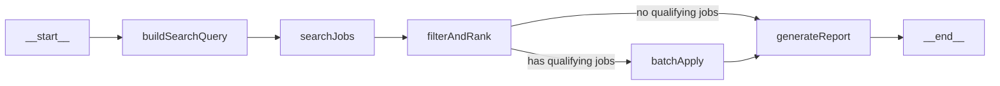

# Job Autopilot Agent — Complete Architecture Design

## The Vision

> User sets their preferences once → Agent wakes up on schedule → Searches the web for matching jobs → Filters & ranks by fit → Runs the One-Click Apply pipeline on each qualifying job → User wakes up to a batch of tailored resumes, cover letters, and cold emails ready to send.

---

## System Architecture



---

## Why a Job Queue (BullMQ)?

This can't be a simple `setTimeout` or `setInterval`. Here's why:

| Problem | Solution with BullMQ |
|---------|---------------------|
| Server restarts kill timers | Jobs persist in Redis, survive restarts |
| Multiple API calls per schedule run | Concurrency control, rate limiting built-in |
| Long-running pipeline (5-10 min per job) | Background workers, won't block HTTP server |
| Failed job searches | Automatic retry with exponential backoff |
| User has 3 schedules running at once | Proper queue management, no race conditions |

> [!IMPORTANT]
> **Simpler alternative for MVP:** If you don't want Redis/BullMQ overhead yet, you can start with **`node-cron`** directly invoking the pipeline in-process. It won't survive restarts but is much simpler to build. I'll show both approaches.

---

## LangGraph Agent Design



### Node Details

#### 1. `buildSearchQuery`
Converts user filters into optimized search queries.

**Input:** User profile + schedule filters (role preferences, location, remote/onsite, experience, salary)
**Output:** Array of search query strings

```javascript
// Example: User profile has skills ["React", "Node.js", "TypeScript"]
// Schedule filters: remote, 0-2 years, posted within 24h

// Generated queries:
[
  "React developer remote entry level jobs posted today",
  "Node.js TypeScript developer remote junior jobs last 24 hours",
  "frontend developer React remote entry level"
]
```

#### 2. `searchJobs`
Calls an external job search API with the generated queries.

**Input:** Array of search queries
**Output:** Raw array of job listings (title, company, location, description snippet, URL, posted date)

**Data source options (see section below).**

#### 3. `filterAndRank`
AI-powered filtering using the user's master profile.

**Input:** Raw job listings + user profile
**Output:** Filtered & ranked jobs with match scores

```javascript
// For each job:
// 1. Quick match score (0-100) using flashModel
// 2. Filter out jobs below threshold (configurable, default: 60)
// 3. Deduplicate (same company + similar title = skip)
// 4. Sort by match score descending
// 5. Cap at maxApplications (from schedule config)
```

#### 4. `batchApply`
Runs the existing `oneClickApply` pipeline for each qualifying job.

**Input:** Array of qualifying jobs + user profile
**Output:** Array of application results

```javascript
// For each qualifying job:
// 1. Fetch full job description (if API only gave snippet)
// 2. Run oneClickApplyGraph.invoke({ jobDescription, userProfile })
// 3. Save Application record to DB
// 4. Link to DiscoveredJob record
// 5. Rate limit: 10-second delay between pipeline runs (avoid API throttling)
```

#### 5. `generateReport`
Summarizes the entire run for user notification.

**Input:** All discovered jobs + application results
**Output:** Human-readable summary

```
📊 Job Autopilot Report — May 27, 2026

🔍 Found: 23 jobs matching your criteria
✅ Qualified (score ≥ 60): 8 jobs
📄 Applications prepared: 5 (capped by your limit)

Top Matches:
1. Frontend Engineer @ Stripe — Score: 92
2. React Developer @ Vercel — Score: 87
3. Full Stack Engineer @ Linear — Score: 81

⚠️ 3 jobs skipped (score below threshold)
```

---

## Database Schema

### New Models

```prisma
model JobSchedule {
  id              String   @id @default(cuid())
  name            String   @default("My Job Search")
  isActive        Boolean  @default(true)
  
  // Schedule Configuration
  cronExpression  String   // "0 8 * * *" = daily at 8 AM
  timezone        String   @default("Asia/Kolkata")
  
  // Search Filters
  targetRoles     Json     // ["Frontend Developer", "React Developer", "Full Stack"]
  locations       Json     // ["Remote", "Bangalore", "San Francisco"]
  workType        String   @default("any")  // "remote", "onsite", "hybrid", "any"
  experienceLevel String   @default("any")  // "entry", "mid", "senior", "any"
  salaryMin       Int?     // Minimum salary (in user's currency)
  salaryMax       Int?     
  postAge         String   @default("24h")  // "24h", "48h", "7d", "30d"
  excludeCompanies Json?   // ["Company I already applied to"]
  
  // Pipeline Settings
  minMatchScore   Int      @default(60)     // Only apply if score >= this
  maxApplications Int      @default(5)      // Max applications per run
  autoApply       Boolean  @default(false)  // If true, auto-submits (future)
  
  // Execution History
  lastRunAt       DateTime?
  lastRunStatus   String?  // "success", "partial", "failed", "no_matches"
  totalJobsFound  Int      @default(0)
  totalApplied    Int      @default(0)
  
  // Relations
  discoveredJobs  DiscoveredJob[]
  userId          String
  user            User     @relation(fields: [userId], references: [id], onDelete: Cascade)
  
  createdAt       DateTime @default(now())
  updatedAt       DateTime @updatedAt
  @@map("job_schedules")
}

model DiscoveredJob {
  id              String   @id @default(cuid())
  
  // Job Data
  title           String
  company         String
  location        String?
  salary          String?
  url             String?
  source          String   // "serpapi", "google_jobs", "manual"
  postedAt        DateTime?
  description     String   @db.Text
  descriptionSnippet String? // Short version from search results
  
  // AI Analysis
  matchScore      Float?
  matchReason     String?  @db.Text  // Why this job was selected/rejected
  
  // Status
  status          String   @default("discovered")
  // "discovered" → "qualified" → "applied" → "skipped" → "rejected_by_filter"
  
  // Link to Application (if pipeline was run)
  applicationId   String?  @unique
  application     Application? @relation(fields: [applicationId], references: [id])
  
  // Link to Schedule
  scheduleId      String
  schedule        JobSchedule @relation(fields: [scheduleId], references: [id], onDelete: Cascade)
  
  createdAt       DateTime @default(now())
  @@map("discovered_jobs")
}
```

### Update Application Model

```prisma
model Application {
  // ... existing fields ...
  
  // Add reverse relation from DiscoveredJob
  discoveredJob   DiscoveredJob?
}
```

### Update User Model

```prisma
model User {
  // ... existing fields ...
  schedules  JobSchedule[]
}
```

---

## Job Data Source — The Hard Part

This is the most critical decision. Here are your realistic options:

### Option A: SerpAPI Google Jobs (Recommended)

| Aspect | Details |
|--------|---------|
| **API** | [SerpAPI](https://serpapi.com/) — `engine: "google_jobs"` |
| **Cost** | $50/mo for 5,000 searches (plenty for daily schedules) |
| **Data Quality** | Excellent — aggregates from LinkedIn, Indeed, Glassdoor, company sites |
| **Filters** | Location, date posted, job type, remote |
| **JD Available?** | Yes, full descriptions via `google_jobs_listing` endpoint |
| **Rate Limits** | Generous (5 req/sec) |

```javascript
// Example SerpAPI call
import { getJson } from "serpapi";

const results = await getJson({
  engine: "google_jobs",
  q: "React developer remote",
  location: "India",
  chips: "date_posted:today",  // "today", "3days", "week", "month"
  api_key: process.env.SERPAPI_KEY,
});

// results.jobs_results → Array of job objects with title, company, description, etc.
```

### Option B: Free Alternative — Scrape Google Jobs (No API Cost)

Use a lightweight scraping approach with `google-jobs-scraper` or custom Playwright scraping.

> [!WARNING]
> **Google blocks automated scraping aggressively.** This works for development and small-scale, but will break in production. Use SerpAPI for reliability.

### Option C: JSearch API on RapidAPI

| Aspect | Details |
|--------|---------|
| **API** | [JSearch](https://rapidapi.com/letscrape-6bRBa3QguO5/api/jsearch) |
| **Cost** | Free tier: 200 requests/month; $30/mo for 10,000 |
| **Data** | Aggregates from LinkedIn, Indeed, Glassdoor |
| **Filters** | date_posted, remote, employment_type |

### Option D: Hybrid (Best of Both)

- **Primary:** SerpAPI for scheduled searches (best quality)
- **Fallback:** JSearch for overflow
- **Manual:** User can always paste a JD directly (existing flow)

> [!IMPORTANT]
> **My recommendation:** Start with **SerpAPI** ($50/mo). It gives you the best data quality and has native Google Jobs integration. Once you validate the feature works, you can add cheaper fallbacks.

---

## API Endpoints

```
POST   /api/autopilot/schedules          → Create a new schedule
GET    /api/autopilot/schedules          → List all user schedules
GET    /api/autopilot/schedules/:id      → Get schedule details + recent runs
PATCH  /api/autopilot/schedules/:id      → Update schedule filters
DELETE /api/autopilot/schedules/:id      → Delete a schedule
POST   /api/autopilot/schedules/:id/run  → Manually trigger a schedule run (for testing)
PATCH  /api/autopilot/schedules/:id/toggle → Activate/deactivate

GET    /api/autopilot/jobs               → List all discovered jobs (with filters)
GET    /api/autopilot/jobs/:id           → Get discovered job details
PATCH  /api/autopilot/jobs/:id/skip      → Mark a discovered job as skipped
POST   /api/autopilot/jobs/:id/apply     → Manually trigger apply pipeline for a discovered job
```

---

## Scheduler Implementation

### MVP Approach: `node-cron` (No Redis needed)

```javascript
// backend/src/scheduler/index.js
import cron from "node-cron";
import prisma from "../lib/prisma.js";
import { runAutopilotForSchedule } from "../agents/autopilot/runner.js";

// Check every minute for schedules that need to run
cron.schedule("* * * * *", async () => {
  const now = new Date();
  
  const activeSchedules = await prisma.jobSchedule.findMany({
    where: { isActive: true },
    include: { user: { include: { profile: true } } },
  });

  for (const schedule of activeSchedules) {
    if (shouldRunNow(schedule.cronExpression, schedule.timezone, now)) {
      console.log(`[Scheduler] Triggering autopilot for schedule: ${schedule.id}`);
      
      // Run in background (don't await — fire and forget)
      runAutopilotForSchedule(schedule).catch((err) => {
        console.error(`[Scheduler] Failed for ${schedule.id}:`, err);
      });
    }
  }
});
```

### Production Approach: BullMQ + Redis

```javascript
// backend/src/scheduler/queue.js
import { Queue, Worker } from "bullmq";
import Redis from "ioredis";

const connection = new Redis(process.env.REDIS_URL);

export const autopilotQueue = new Queue("autopilot", { connection });

// Add repeatable jobs when user creates a schedule
export async function addScheduleToQueue(schedule) {
  await autopilotQueue.add(
    `autopilot-${schedule.id}`,
    { scheduleId: schedule.id },
    {
      repeat: { cron: schedule.cronExpression, tz: schedule.timezone },
      jobId: schedule.id,
    }
  );
}

// Worker processes jobs
const worker = new Worker("autopilot", async (job) => {
  const { scheduleId } = job.data;
  const schedule = await prisma.jobSchedule.findUnique({
    where: { id: scheduleId },
    include: { user: { include: { profile: true } } },
  });
  
  if (!schedule || !schedule.isActive) return;
  
  await runAutopilotForSchedule(schedule);
}, { connection, concurrency: 2 });
```

---

## Frontend — Schedule Configuration UI

### `/autopilot` Page

The scheduling page needs these sections:

#### 1. Schedule Builder Card
```
┌─────────────────────────────────────────────┐
│  🤖 Job Autopilot                           │
│                                             │
│  Schedule Name: [My Daily Job Hunt      ]   │
│                                             │
│  ⏰ Run Frequency                           │
│  ┌─────────┐ ┌─────────┐ ┌─────────┐       │
│  │ Daily   │ │ 2x/day  │ │ Weekly  │       │
│  └─────────┘ └─────────┘ └─────────┘       │
│  Time: [08:00 AM ▼]  Timezone: [IST ▼]     │
│                                             │
│  🎯 Job Filters                             │
│  Target Roles: [+ Add Role]                 │
│  ┌─────────────┐ ┌──────────────┐           │
│  │ React Dev ✕ │ │ Frontend ✕   │           │
│  └─────────────┘ └──────────────┘           │
│                                             │
│  📅 Post Age        🌍 Location             │
│  ┌──────────────┐   ┌──────────────┐        │
│  │ Last 24 hrs ▼│   │ Remote     ▼ │        │
│  └──────────────┘   └──────────────┘        │
│                                             │
│  💼 Experience       💰 Salary Range        │
│  ┌──────────────┐   ┌──────────────┐        │
│  │ Entry Level ▼│   │ $50k - $80k  │        │
│  └──────────────┘   └──────────────┘        │
│                                             │
│  ⚙️ Pipeline Settings                       │
│  Min Match Score: [====●=========] 60       │
│  Max Applications/Run: [5 ▼]               │
│                                             │
│  ┌─────────────────┐  ┌──────────────┐      │
│  │ 🚀 Activate     │  │ ▶ Test Run   │      │
│  └─────────────────┘  └──────────────┘      │
└─────────────────────────────────────────────┘
```

#### 2. Active Schedules List
Shows all schedules with status, last run time, and toggle switch.

#### 3. Discovered Jobs Feed
A feed showing all jobs the autopilot found, with match scores, quick-apply buttons, and skip options.

#### 4. Run History
Timeline of past autopilot runs with summary reports.

---

## Realistic Constraints & Solutions

| Challenge | Solution |
|-----------|----------|
| **SerpAPI costs money** | Start with 5 searches/schedule/run (3 query variations). $50/mo covers ~30 daily users |
| **Pipeline is slow (~30s per job)** | Run max 5 applications per schedule. Use `Promise.allSettled` with concurrency limit |
| **Rate limits on LLM** | Add 10-second delays between pipeline runs. Use `flashModel` for filtering, `proModel` only for resume/cover letter |
| **Duplicate applications** | Check `Application.jobDescription` similarity before running pipeline. Store job URLs in `DiscoveredJob` for dedup |
| **Server restart kills schedules** | MVP: Re-register crons on server boot from DB. Production: BullMQ persists in Redis |
| **Vercel serverless can't run crons** | Use **Vercel Cron Jobs** (`vercel.json` config) or a separate always-on server (Railway, Render) for the scheduler |
| **User is asleep when jobs run** | Email notification with the autopilot report. In-app notification badge on dashboard |

> [!WARNING]
> **Deployment consideration:** Your backend runs on Vercel serverless. Serverless functions have a max execution time (10s on free, 60s on Pro). The autopilot pipeline needs minutes. You'll need either:
> 1. **Vercel Cron + background function** (Vercel Pro's `maxDuration: 300`)
> 2. **Separate worker service** on Railway/Render (~$5/mo) that handles just the autopilot queue
> 3. **Keep Vercel for API** + use an external cron service (cron-job.org, free) to hit your `/schedules/:id/run` endpoint

---

## New Dependencies

```bash
npm install node-cron serpapi
# Optional for production:
npm install bullmq ioredis
```

---

## Implementation Order

| Step | What | Effort |
|------|------|--------|
| 1 | Add `JobSchedule` + `DiscoveredJob` to Prisma schema | 30 min |
| 2 | Build the Autopilot LangGraph (5 nodes) | 3-4 hrs |
| 3 | Create CRUD API for schedules | 1-2 hrs |
| 4 | Wire up `node-cron` scheduler | 1-2 hrs |
| 5 | Build frontend `/autopilot` page | 3-4 hrs |
| 6 | Add email notifications for reports | 1-2 hrs |
| 7 | (Later) Migrate to BullMQ for production | 2-3 hrs |

**Total estimated: ~12-16 hours**

---

## How It Connects to Your Existing Code

The beauty is that `batchApply` node simply calls your existing [`oneClickApplyGraph`](file:///Users/ayushkumarray/100xAyush/Projects/Resume-Agent/backend/src/agents/oneClickApply/graph.js) for each job — zero duplication:

```javascript
// Inside batchApply node
import { oneClickApplyGraph } from "../oneClickApply/graph.js";

for (const job of qualifyingJobs) {
  const result = await oneClickApplyGraph.invoke({
    jobDescription: job.fullDescription,
    userProfile: state.userProfile,
  });
  
  // Save Application record (same as apply.controller.js does)
  await prisma.application.create({
    data: {
      userId: state.userId,
      jobDescription: job.fullDescription,
      status: "completed",
      parsedJob: result.parsedJob,
      matchScore: result.matchResult?.score,
      matchAnalysis: result.matchResult,
      tailoredResume: result.tailoredResume,
      coverLetter: result.coverLetter,
      coldEmail: result.coldEmail,
    },
  });
}
```
