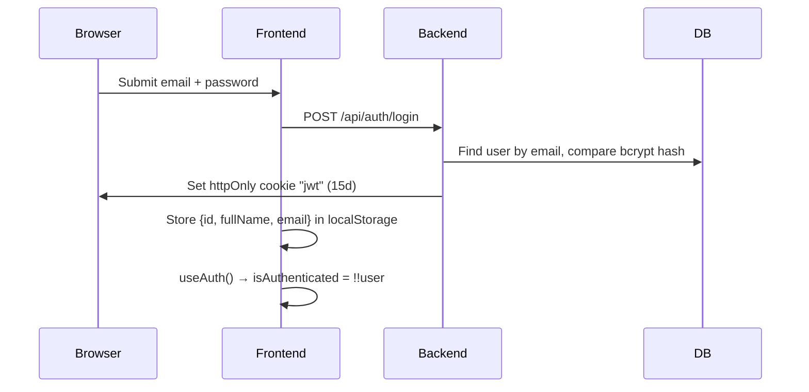
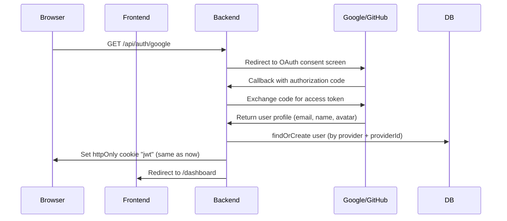

# Adding Google/GitHub OAuth — Impact Analysis

## Your Current Auth Architecture

Your auth flow is straightforward email/password + JWT cookie:



### Key Touchpoints

| Layer | File | What it does |
|-------|------|-------------|
| DB Schema | [schema.prisma](file:///Users/ayushkumarray/100xAyush/Projects/Resume-Agent/backend/prisma/schema.prisma#L16-L31) | `User` model has **required** `password` field |
| JWT generation | [jwt.js](file:///Users/ayushkumarray/100xAyush/Projects/Resume-Agent/backend/src/lib/jwt.js) | Signs `{ userId }` into cookie named `jwt` |
| Auth middleware | [auth.middleware.js](file:///Users/ayushkumarray/100xAyush/Projects/Resume-Agent/backend/src/middleware/auth.middleware.js) | Reads `req.cookies.jwt`, verifies, attaches `req.user` |
| Auth controller | [auth.controller.js](file:///Users/ayushkumarray/100xAyush/Projects/Resume-Agent/backend/src/controller/auth.controller.js) | Signup (bcrypt hash), Login (bcrypt compare), Logout (clear cookie) |
| Auth routes | [auth.route.js](file:///Users/ayushkumarray/100xAyush/Projects/Resume-Agent/backend/src/routes/auth.route.js) | `/signup`, `/login`, `/logout`, `/updateProfile` |
| Frontend context | [AuthContext.tsx](file:///Users/ayushkumarray/100xAyush/Projects/Resume-Agent/frontend/src/contexts/AuthContext.tsx) | Stores user in `localStorage`, exposes `isAuthenticated = !!user` |
| Frontend guard | [layout.tsx](file:///Users/ayushkumarray/100xAyush/Projects/Resume-Agent/frontend/src/app/(app)/layout.tsx#L37-L44) | Redirects to `/login` if `!isAuthenticated` |
| Login page | [login/page.tsx](file:///Users/ayushkumarray/100xAyush/Projects/Resume-Agent/frontend/src/app/(auth)/login/page.tsx) | Email + password form → `POST /auth/login` |
| Sidebar | [AppSidebar.tsx](file:///Users/ayushkumarray/100xAyush/Projects/Resume-Agent/frontend/src/components/AppSidebar.tsx#L241-L292) | Displays `user.fullName`, `user.email`, initials avatar |

---

## Changes Required

### 1. Database Schema

```diff
 model User {
   id        String   @id @default(cuid())
   fullName  String
   email     String   @unique
-  password  String
+  password  String?                // Optional — OAuth users won't have one
+
+  // OAuth fields
+  provider  String   @default("local")  // "local" | "google" | "github"
+  providerId String?                    // OAuth provider's unique user ID
+  avatar     String?                    // Profile picture URL from OAuth
 
   createdAt DateTime @default(now())
   updatedAt DateTime @updatedAt
   // ... relations unchanged
+
+  @@unique([provider, providerId])     // Prevent duplicate OAuth accounts
   @@map("users")
 }
```

> [!WARNING]
> Making `password` optional is the **single biggest breaking change**. Every place that currently does `bcrypt.compare(password, user.password)` will crash on OAuth users because `user.password` will be `null`.

### 2. Backend — New OAuth Routes & Controller

You'll need a library like **Passport.js** (with `passport-google-oauth20` + `passport-github2`) or handle the OAuth flow manually. Here's the flow either way:



#### New files needed:

| File | Purpose |
|------|---------|
| `src/controller/oauth.controller.js` | Handle Google/GitHub callback, findOrCreate user, generate JWT |
| `src/routes/oauth.route.js` | `GET /auth/google`, `GET /auth/google/callback`, same for github |
| `src/lib/passport.js` *(if using Passport)* | Configure strategies |

#### Changes to existing files:

##### [auth.controller.js](file:///Users/ayushkumarray/100xAyush/Projects/Resume-Agent/backend/src/controller/auth.controller.js)

```diff
 // In login handler — guard against OAuth-only users
 const isPasswordCorrect = await bcrypt.compare(password, user.password);
+
+// NEW: OAuth users can't login with password
+if (!user.password) {
+  return res.status(400).json({
+    msg: `This account uses ${user.provider} login. Please sign in with ${user.provider}.`
+  });
+}
```

##### [auth.controller.js](file:///Users/ayushkumarray/100xAyush/Projects/Resume-Agent/backend/src/controller/auth.controller.js) — signup

```diff
 // In signup handler — set provider to "local"
 const newUser = await prisma.user.create({
   data: {
     fullName,
     email,
     password: hashedPassword,
+    provider: "local",
   },
 });
```

##### [index.js](file:///Users/ayushkumarray/100xAyush/Projects/Resume-Agent/backend/src/index.js)

```diff
+import oauthRoute from "./routes/oauth.route.js";
+// If using Passport:
+import passport from "passport";
+import "./lib/passport.js"; // Initialize strategies

 app.use("/api/auth", authRoute);
+app.use("/api/auth", oauthRoute);   // Mounts /api/auth/google, etc.
+// If using Passport:
+app.use(passport.initialize());
```

##### [auth.middleware.js](file:///Users/ayushkumarray/100xAyush/Projects/Resume-Agent/backend/src/middleware/auth.middleware.js)

> [!TIP]
> **Good news: No changes needed here!** Your middleware reads `req.cookies.jwt` and verifies `{ userId }`. As long as OAuth users also get the same JWT cookie (which they will), the middleware works identically. This is the benefit of having a unified JWT layer.

### 3. Environment Variables

```env
# Google OAuth
GOOGLE_CLIENT_ID=your_google_client_id
GOOGLE_CLIENT_SECRET=your_google_client_secret
GOOGLE_CALLBACK_URL=http://localhost:5000/api/auth/google/callback

# GitHub OAuth  
GITHUB_CLIENT_ID=your_github_client_id
GITHUB_CLIENT_SECRET=your_github_client_secret
GITHUB_CALLBACK_URL=http://localhost:5000/api/auth/github/callback
```

### 4. Frontend Changes

##### [login/page.tsx](file:///Users/ayushkumarray/100xAyush/Projects/Resume-Agent/frontend/src/app/(auth)/login/page.tsx) & signup

Add OAuth buttons that simply redirect to the backend:

```tsx
{/* Add below the login form, before the signup link */}
<div className="relative my-6">
  <div className="absolute inset-0 flex items-center">
    <div className="w-full border-t border-border" />
  </div>
  <div className="relative flex justify-center text-xs uppercase">
    <span className="bg-white px-2 text-muted-foreground">Or continue with</span>
  </div>
</div>

<div className="grid grid-cols-2 gap-3">
  <a href={`${API_URL}/auth/google`} className="flat-btn-secondary h-11 ...">
    <GoogleIcon /> Google
  </a>
  <a href={`${API_URL}/auth/github`} className="flat-btn-secondary h-11 ...">
    <GithubIcon /> GitHub
  </a>
</div>
```

##### [AuthContext.tsx](file:///Users/ayushkumarray/100xAyush/Projects/Resume-Agent/frontend/src/contexts/AuthContext.tsx)

This needs the **biggest frontend change**. Currently:
- Login stores user data from the API response in localStorage
- `isAuthenticated = !!user` (from localStorage)

The problem: **OAuth users get redirected back from the backend, they never call the frontend `login()` function**. So localStorage never gets set.

**Fix — add a `/api/auth/me` check-session endpoint:**

```diff
 useEffect(() => {
-  // Check if user is logged in on mount
-  const storedUser = localStorage.getItem("user");
-  if (storedUser) {
-    try {
-      setUser(JSON.parse(storedUser));
-    } catch (error) { ... }
-  }
-  setIsLoading(false);
+  // Validate session with the server on mount
+  const checkAuth = async () => {
+    try {
+      const res = await axiosAPI.get("/auth/me");
+      setUser(res.data);
+      localStorage.setItem("user", JSON.stringify(res.data));
+    } catch {
+      setUser(null);
+      localStorage.removeItem("user");
+    } finally {
+      setIsLoading(false);
+    }
+  };
+  checkAuth();
 }, []);
```

And on the backend, add a simple `/auth/me` route:

```js
// auth.route.js
router.get("/me", protectRoute, (req, res) => {
  res.json(req.user);  // req.user is already set by protectRoute
});
```

> [!IMPORTANT]
> This `/auth/me` approach is actually **more secure** than your current localStorage-only check. Right now, if the JWT cookie expires but localStorage still has user data, the frontend thinks the user is authenticated but every API call fails with 401. The `/auth/me` check fixes this desync.

##### [AppSidebar.tsx](file:///Users/ayushkumarray/100xAyush/Projects/Resume-Agent/frontend/src/components/AppSidebar.tsx)

Optionally show the OAuth avatar instead of initials:

```tsx
{user?.avatar ? (
  
) : (
  <div className="w-8 h-8 rounded-lg bg-zinc-900 text-white ...">
    {getInitials(user?.fullName)}
  </div>
)}
```

Update the `User` interface in AuthContext to include `avatar?: string` and `provider?: string`.

---

## What Could Break

### 🔴 Critical Breaks

| Issue | Why | Where |
|-------|-----|-------|
| **`password` is required in DB** | OAuth users have no password → `prisma.user.create()` fails if password is still required | [schema.prisma:20](file:///Users/ayushkumarray/100xAyush/Projects/Resume-Agent/backend/prisma/schema.prisma#L20) |
| **Login with null password** | `bcrypt.compare(password, null)` throws | [auth.controller.js:77](file:///Users/ayushkumarray/100xAyush/Projects/Resume-Agent/backend/src/controller/auth.controller.js#L77) |
| **OAuth redirect doesn't set localStorage** | User lands on `/dashboard` after OAuth but `AuthContext` reads from localStorage → `isAuthenticated` is `false` → redirect loop to `/login` | [AuthContext.tsx:37-46](file:///Users/ayushkumarray/100xAyush/Projects/Resume-Agent/frontend/src/contexts/AuthContext.tsx#L35-L47) |

### 🟡 Subtle Issues

| Issue | Why |
|-------|-----|
| **Duplicate accounts** | User signs up with email/password, then later clicks "Login with Google" using the same email → creates a second user with different ID → all their resumes/applications are on the old account |
| **Rate limiter on OAuth routes** | Your `authLimiter` is on `/signup` and `/login` but you'll need to decide if OAuth routes should be rate-limited too |
| **CORS for redirect flow** | OAuth uses full-page redirects (not AJAX), so CORS isn't an issue for the OAuth flow itself, but the callback redirect URL to the frontend needs to be correct |
| **Cookie SameSite** | You have `sameSite: "none"` in production — this is correct for cross-origin cookies but make sure the OAuth callback domain matches |
| **Profile update assumes fullName** | [updateProfile](file:///Users/ayushkumarray/100xAyush/Projects/Resume-Agent/backend/src/controller/auth.controller.js#L111-L134) only updates `fullName`, not avatar or provider — minor but worth noting |

### 🟢 Things That Won't Break

| Component | Why it's safe |
|-----------|--------------|
| **`protectRoute` middleware** | Reads JWT cookie → same for OAuth and local users ✅ |
| **All protected routes** (resume, apply, profile, autopilot) | They just use `req.user.id` from middleware → unchanged ✅ |
| **Logout** | Clears the `jwt` cookie → same for all auth types ✅ |
| **Prisma relations** | Everything links to `User.id` → doesn't care how the user was created ✅ |
| **Sidebar, dashboard, all UI** | They read `user.fullName` and `user.email` from context → OAuth provides both ✅ |

---

## Recommended Account Linking Strategy

To handle the "same email, different provider" problem:

```js
// In your OAuth callback handler
async function findOrCreateOAuthUser(profile, provider) {
  // 1. Check if user exists with this OAuth provider
  let user = await prisma.user.findFirst({
    where: { provider, providerId: profile.id }
  });
  if (user) return user;

  // 2. Check if email already exists (local account)
  user = await prisma.user.findUnique({
    where: { email: profile.email }
  });
  if (user) {
    // Link the OAuth provider to existing account
    return await prisma.user.update({
      where: { id: user.id },
      data: { provider, providerId: profile.id, avatar: profile.avatar }
    });
  }

  // 3. Create brand new user
  return await prisma.user.create({
    data: {
      fullName: profile.name,
      email: profile.email,
      provider,
      providerId: profile.id,
      avatar: profile.avatar,
      // password is null — that's fine now
    }
  });
}
```

> [!CAUTION]
> The simple linking above overwrites the `provider` field, meaning a user can only have ONE linked provider. If you want to support **multiple providers per user** (Google AND GitHub AND local password), you'd need a separate `Account` model (like what NextAuth/Auth.js does). That's a bigger schema change.

---

## Summary of All Files to Touch

| File | Change Type |
|------|------------|
| `prisma/schema.prisma` | Modify — make password optional, add provider fields |
| `src/lib/passport.js` | **New** — OAuth strategy configuration |
| `src/controller/oauth.controller.js` | **New** — OAuth callback handlers |
| `src/routes/oauth.route.js` | **New** — OAuth routes |
| `src/controller/auth.controller.js` | Modify — guard bcrypt against null password |
| `src/routes/auth.route.js` | Modify — add `/me` endpoint |
| `src/index.js` | Modify — register new routes |
| `.env` | Modify — add OAuth client IDs/secrets |
| `frontend/src/contexts/AuthContext.tsx` | Modify — add `/auth/me` session check, update User type |
| `frontend/src/app/(auth)/login/page.tsx` | Modify — add OAuth buttons |
| `frontend/src/app/(auth)/signup/page.tsx` | Modify — add OAuth buttons |
| `frontend/src/components/AppSidebar.tsx` | Minor — optionally show avatar |
