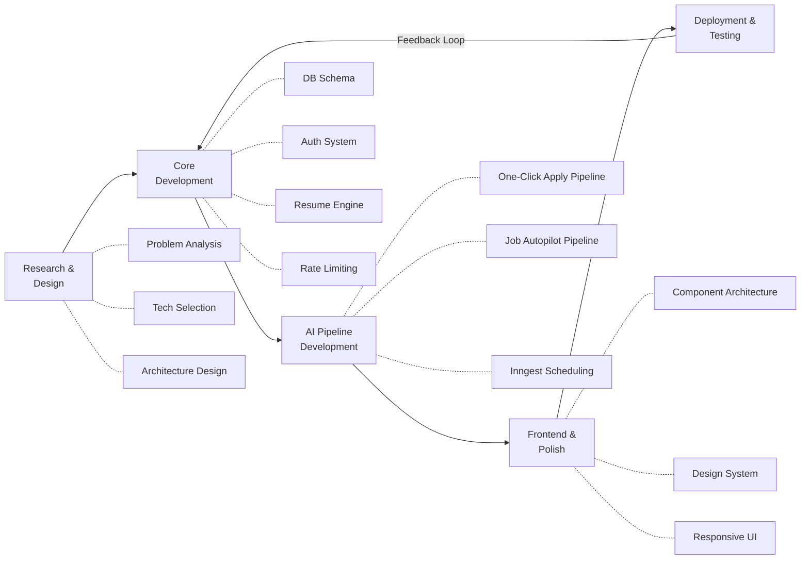
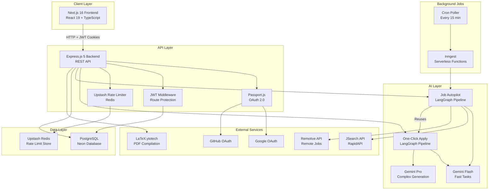
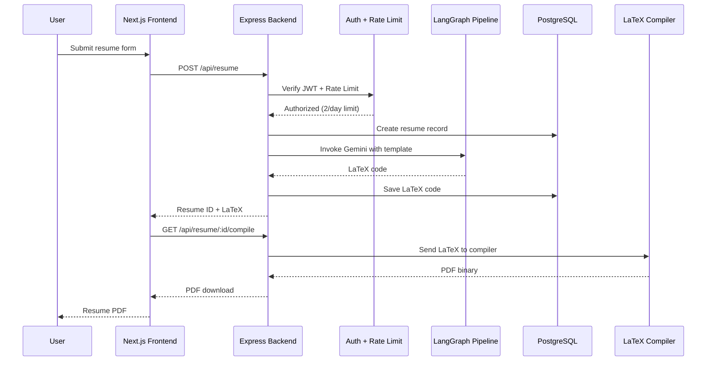
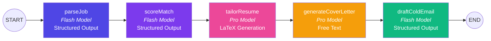
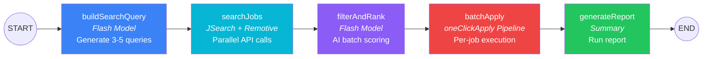
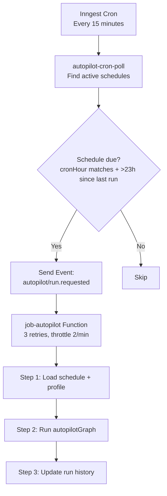
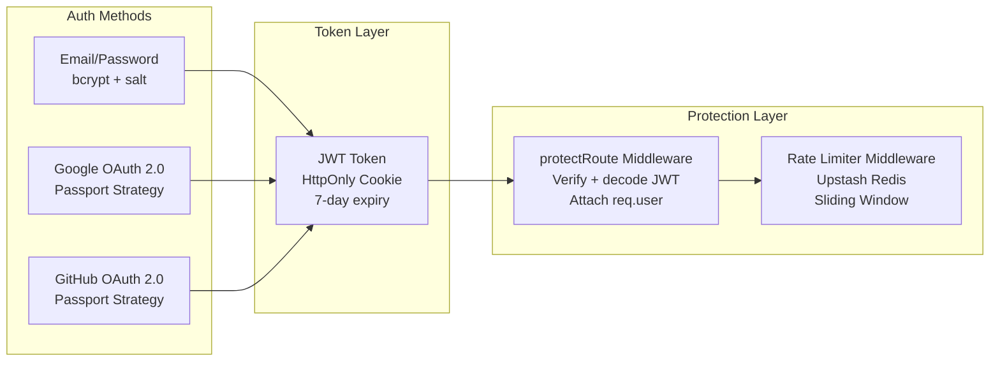
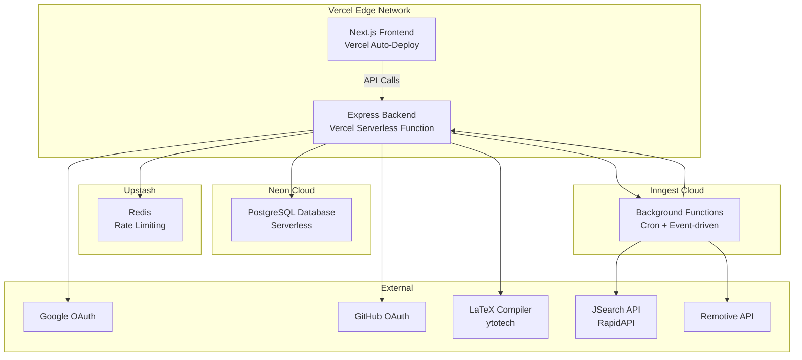

# AI CareerCrew AI — Project Report

> **Project Title:** AI CareerCrew AI — Intelligent Career Automation Suite
> **Author:** Ayush Kumar Ray
> **Date:** June 12, 2026
> **Repository:** [AyushRay06/Resume-Generator](https://github.com/AyushRay06/Resume-Generator)
> **Live URL:** [resumeai.ayushray.in](https://resumeai.ayushray.in)
> **Version:** 1.0.0 | **License:** MIT

---

## Table of Contents

1. [Abstract](#1-abstract)
2. [Objectives](#2-objectives)
3. [Methodology](#3-methodology)
4. [Executive Summary](#4-executive-summary)
5. [Project Objectives & Status](#5-project-objectives--status)
6. [Technology Stack](#6-technology-stack)
7. [System Architecture](#7-system-architecture)
8. [Database Design](#8-database-design)
9. [AI Pipeline Architecture](#9-ai-pipeline-architecture)
10. [Backend — Module Breakdown](#10-backend--module-breakdown)
11. [Frontend — Module Breakdown](#11-frontend--module-breakdown)
12. [API Documentation](#12-api-documentation)
13. [Authentication & Security](#13-authentication--security)
14. [Deployment Architecture](#14-deployment-architecture)
15. [Feature Analysis](#15-feature-analysis)
16. [Development Timeline](#16-development-timeline)
17. [Project Statistics](#17-project-statistics)
18. [Limitations & Future Scope](#18-limitations--future-scope)
19. [Conclusion](#19-conclusion)

---

## 1. Abstract

The modern job market demands highly tailored application materials for every role, yet the manual effort of customizing resumes, writing cover letters, and crafting outreach emails for each opportunity is both time-intensive and error-prone. This project presents **AI CareerCrew AI**, an intelligent career automation suite that leverages Large Language Models (LLMs) and multi-step AI agent architectures to automate the end-to-end job application workflow.

The system employs **LangGraph** — a directed acyclic graph (DAG) framework from LangChain — to orchestrate two distinct AI pipelines. The **One-Click Apply Pipeline** is a 5-node sequential graph that accepts a raw job description and produces a tailored ATS-optimized LaTeX resume, a personalized cover letter, and a cold outreach email in a single invocation. The **Job Autopilot Pipeline** extends this further by autonomously discovering job listings across multiple aggregation APIs (JSearch via RapidAPI, Remotive), AI-scoring each listing against the user's master profile using batch structured output, and programmatically invoking the One-Click Apply pipeline for qualifying matches — all scheduled via Inngest background functions on configurable cron intervals.

The platform is built as a full-stack web application using **Next.js 16** (React 19, TypeScript) for the frontend, **Express.js 5** (Node.js) for the backend REST API, **PostgreSQL** (via Prisma ORM) for persistent storage, and **Upstash Redis** for distributed rate limiting. Authentication supports both traditional email/password (bcrypt + JWT) and **OAuth 2.0** (Google, GitHub) via Passport.js. The system is deployed on **Vercel** (serverless) with a **Neon** PostgreSQL database.

Key results demonstrate that the system can parse a job description, compute a profile match score, and generate three complete, job-specific application documents (resume, cover letter, cold email) in under 60 seconds. The Job Autopilot can discover, score, and prepare applications for up to 5 jobs per run cycle without any manual intervention.

**Keywords:** AI Agents, LangGraph, LLM, Resume Generation, ATS Optimization, LaTeX, Job Search Automation, LangChain, Next.js, Full-Stack Development

---

## 2. Objectives

The primary objective of this project is to design and develop an AI-powered career automation platform that reduces the manual effort required in the job application process. The specific objectives are:

### 2.1 Primary Objectives

1. **Automate Resume Tailoring** — Design a system that accepts a user's career data and a target job description, and uses AI to generate a uniquely tailored, ATS-compliant LaTeX resume that emphasizes relevant skills, rephrases experience with job-specific keywords, and follows a professional formatting template.

2. **Implement Multi-Step AI Agents** — Build multi-node AI pipelines using LangGraph that decompose the application preparation process into discrete, composable steps (job parsing → match scoring → resume generation → cover letter → cold email), enabling structured output validation and pipeline reusability.

3. **Autonomous Job Discovery & Application** — Develop a fully autonomous "Job Autopilot" system that periodically searches for job listings across multiple sources, evaluates each listing against the user's profile using AI scoring, and automatically generates tailored application materials for qualifying matches.

### 2.2 Secondary Objectives

4. **Centralized Profile Management** — Create a "Master Profile" system where users store their career data once and reuse it across multiple applications, with one-click import from previously created resumes.

5. **Secure, Production-Grade Infrastructure** — Implement industry-standard authentication (JWT + OAuth 2.0), distributed rate limiting (Redis sliding window), and deploy the application as a scalable serverless architecture.

6. **Professional User Experience** — Build a polished, responsive frontend with modern design patterns (dark mode, animations, glassmorphism) that provides an intuitive interface for all platform features.

### 2.3 Learning Objectives

7. **AI Agent Architecture** — Gain practical experience building stateful, multi-step AI agent systems using LangGraph with structured Zod-validated outputs.

8. **Full-Stack Integration** — Demonstrate end-to-end integration of AI capabilities with a production web application, including asynchronous pipeline execution, background job scheduling, and external API orchestration.

---

## 3. Methodology

The development of AI CareerCrew AI followed an **iterative, feature-driven methodology** combining elements of Agile development with a research-oriented approach to AI integration. The project was structured into four major phases:

### 3.1 Phase 1: Research & Design

**Duration:** Initial sprint

- **Problem Analysis:** Studied existing resume builders (e.g., Overleaf, Resumake, Kickresume) and identified that none offered AI-driven tailoring against specific job descriptions or autonomous job discovery.
- **Technology Selection:** Evaluated AI orchestration frameworks (LangChain, LangGraph, CrewAI) and selected **LangGraph** for its explicit DAG-based state management, composability, and structured output support via Zod schemas.
- **Architecture Planning:** Designed a decoupled full-stack architecture with a clear separation between the Express REST API (backend), Next.js SPA (frontend), and AI pipeline layer (LangGraph agents). Chose PostgreSQL for relational data (users, resumes, applications, schedules) and Redis for ephemeral rate-limiting state.
- **LaTeX Template Design:** Researched ATS (Applicant Tracking System) parsing patterns and designed a LaTeX resume template optimized for both human readability and machine parsability, using standard section ordering and keyword-friendly formatting.

### 3.2 Phase 2: Core Development

**Duration:** Primary development sprints

- **Database Schema Design:** Defined 6 Prisma models (`User`, `Resume`, `UserProfile`, `Application`, `JobSchedule`, `DiscoveredJob`) with proper relational mappings, cascading deletes, and JSON fields for flexible career data storage.
- **Authentication System:** Implemented a dual authentication strategy:
  - **Local auth:** bcrypt password hashing (10 salt rounds) + JWT tokens stored in HttpOnly cookies (7-day expiry)
  - **OAuth 2.0:** Passport.js strategies for Google and GitHub with find-or-create user logic
- **Resume Generation Engine:** Built the core AI resume generation using the OpenAI SDK configured against the Gemini API endpoint, with system prompts that enforce strict LaTeX template compliance, special character escaping, and job-specific tailoring.
- **Rate Limiting:** Integrated Upstash Redis with sliding window rate limiters (2 resumes/24h per user, 5 auth attempts/15min per IP) with a fail-open strategy to maintain availability.

### 3.3 Phase 3: AI Pipeline Development

**Duration:** Feature sprints for LangGraph integration

- **One-Click Apply Pipeline:** Designed and implemented a 5-node LangGraph StateGraph:
  1. `parseJob` — Structured extraction of job requirements using `flashModel.withStructuredOutput(ParsedJobSchema)`
  2. `scoreMatch` — AI match scoring (0–100) with strengths, gaps, and suggestions using `MatchResultSchema`
  3. `tailorResume` — Full LaTeX resume generation using `proModel` with the LaTeX template injected into the system prompt
  4. `generateCoverLetter` — Professional cover letter generation via `proModel`
  5. `draftColdEmail` — Structured cold email drafting using `flashModel.withStructuredOutput(ColdEmailSchema)`

- **Job Autopilot Pipeline:** Extended the architecture with a second 5-node LangGraph pipeline:
  1. `buildSearchQuery` — AI-generates 3–5 optimized search query strings from user profile + schedule filters
  2. `searchJobs` — Parallel API calls to JSearch (RapidAPI) and Remotive, with deduplication
  3. `filterAndRank` — Batch AI scoring (groups of 10) with database persistence of all discovered jobs
  4. `batchApply` — Sequential invocation of the One-Click Apply pipeline per qualified job (5s throttle)
  5. `generateReport` — Human-readable summary generation

- **Background Scheduling:** Integrated Inngest for serverless background function execution with two functions:
  - A cron-triggered poller (`*/15 * * * *`) that checks all active schedules
  - An event-driven handler (`autopilot/run.requested`) that executes the autopilot pipeline with 3 retries and 2/min throttle

### 3.4 Phase 4: Frontend Development & Polish

**Duration:** UI/UX sprints

- **Component Architecture:** Built with Next.js 16 App Router using route groups (`(auth)` for login/signup, `(app)` for dashboard pages), with a shared sidebar layout and protected route guards.
- **Design System:** Used Tailwind CSS v4 with Radix UI primitives for accessible headless components, augmented with Framer Motion animations, Three.js 3D effects, and custom UI components (rainbow buttons, glassmorphism cards, animated beams).
- **State Management:** React Context for global auth state, with per-page data fetching via Axios and local component state for forms.
- **Responsive Design:** Mobile-first approach with custom hooks (`use-mobile`, `use-media-query`) and responsive sidebar collapse.

### 3.5 Development Tools & Practices

| Practice | Tool/Approach |
|----------|---------------|
| Version Control | Git (46 commits, feature-branched) |
| Package Management | npm with lockfile |
| API Testing | Manual testing + standalone pipeline test scripts |
| Database Migrations | Prisma Migrate |
| Environment Management | dotenv with `.env.example` template |
| Deployment | Vercel (auto-deploy from Git) |
| Code Organization | MVC pattern (routes → controllers → models/agents) |
| AI Output Validation | Zod schemas for all structured LLM outputs |
| Error Handling | Retry with exponential backoff for rate-limited AI calls |
| Containerization | Dockerfile (Node 18 Alpine) for self-hosted deployment |

### 3.6 Methodology Diagram



---

## 4. Executive Summary

**AI CareerCrew AI** is a full-stack, AI-powered career automation platform that intelligently generates ATS-optimized LaTeX resumes, cover letters, and cold outreach emails tailored to specific job descriptions. The system goes beyond simple resume building by implementing **two distinct AI agent pipelines** powered by LangGraph:

1. **One-Click Apply Pipeline** — A 5-node LangGraph agent that parses a job description, scores the user's profile against it, generates a tailored LaTeX resume, writes a custom cover letter, and drafts a cold email — all in a single click.

2. **Job Autopilot Pipeline** — A fully autonomous 5-node LangGraph agent that searches for jobs across multiple APIs (JSearch, Remotive), AI-scores each listing against the user's profile, and batch-applies to qualifying positions using the One-Click Apply pipeline. This runs on a configurable cron schedule via Inngest.

The platform features a polished Next.js 16 frontend with Framer Motion animations, a responsive sidebar-based dashboard, OAuth 2.0 authentication (Google + GitHub), and Redis-based rate limiting. It is deployed on Vercel with a PostgreSQL database hosted on Neon.

---

## 5. Project Objectives & Status

| # | Objective | Status |
|---|-----------|--------|
| 1 | Generate ATS-friendly, professionally formatted LaTeX resumes from user-provided data | ✅ Completed |
| 2 | Tailor each resume uniquely against a specific job description using AI | ✅ Completed |
| 3 | Compile LaTeX to downloadable PDF via external compilation API | ✅ Completed |
| 4 | Implement a "One-Click Apply" pipeline that generates resume, cover letter, and cold email | ✅ Completed |
| 5 | Build an autonomous "Job Autopilot" that discovers, scores, and applies to jobs automatically | ✅ Completed |
| 6 | Provide secure user authentication with JWT cookies and OAuth 2.0 (Google, GitHub) | ✅ Completed |
| 7 | Prevent abuse with tiered rate limiting (Upstash Redis) | ✅ Completed |
| 8 | Master Profile system to centralize user data for pipeline reuse | ✅ Completed |
| 9 | Full-featured dashboard with resume management, application tracking, and job discovery | ✅ Completed |
| 10 | Production deployment with Vercel serverless backend + Next.js frontend | ✅ Completed |

---

## 6. Technology Stack

### 3.1 Frontend

| Category | Technology | Version | Purpose |
|----------|-----------|---------|---------|
| Framework | Next.js | 16.1.6 | React-based full-stack framework with App Router |
| UI Library | React | 19.1.0 | Component-based UI rendering |
| Language | TypeScript | 5.x | Type-safe JavaScript |
| Styling | Tailwind CSS | 4.x | Utility-first CSS framework |
| Animations | Framer Motion | 12.31.0 | Production-grade motion library |
| Component Library | Radix UI | 1.5.0 | Accessible headless UI primitives |
| Icons | Lucide React / Tabler | Latest | Icon systems |
| Carousel | Embla Carousel | 8.6.0 | Touch-friendly carousels |
| 3D Rendering | Three.js / React Three Fiber | 0.180.0 | 3D globe and effects on landing page |
| Notifications | React Hot Toast | 2.6.0 | Toast notifications |
| Theming | next-themes | 0.4.6 | Dark/light mode support |
| HTTP Client | Axios | 1.12.2 | API communication |
| Font | Plus Jakarta Sans | — | Google Font via `next/font` |

### 3.2 Backend

| Category | Technology | Version | Purpose |
|----------|-----------|---------|---------|
| Runtime | Node.js | 18+ | JavaScript runtime |
| Framework | Express.js | 5.1.0 | HTTP server and routing |
| Database ORM | Prisma | 6.16.1 | Type-safe database access |
| Database | PostgreSQL | — | Primary relational database |
| AI SDK | OpenAI SDK | 5.20.2 | LLM API calls (configured for Gemini) |
| AI Orchestration | LangChain + LangGraph | Latest | Multi-step AI agent pipelines |
| Background Jobs | Inngest | 4.4.0 | Serverless background function execution |
| Rate Limiting | Upstash Redis + Ratelimit | 2.0.8 | Distributed rate limiting |
| Authentication | JWT + bcryptjs | — | Token-based auth with password hashing |
| OAuth | Passport.js | 0.7.0 | Google & GitHub OAuth 2.0 |
| Validation | Zod | 4.4.3 | Runtime schema validation for AI outputs |

### 3.3 AI Models Used

| Model | Provider | Usage |
|-------|----------|-------|
| `gemini-3-flash-preview` | Google DeepMind | Resume generation, job parsing, match scoring, cold email drafting |
| `gemini-2.0-flash` (via LangChain) | Google DeepMind | LangGraph pipeline nodes (flash model — fast tasks) |
| `gemini-2.5-pro` (via LangChain) | Google DeepMind | LangGraph pipeline nodes (pro model — resume tailoring, cover letters) |

### 3.4 External APIs

| API | Provider | Purpose |
|-----|----------|---------|
| LaTeX.ytotech.com | YtoTech | LaTeX → PDF compilation |
| JSearch | RapidAPI | Job search aggregation (Google Jobs, LinkedIn, Indeed, Glassdoor) |
| Remotive | Remotive.com | Remote job listings (free, no key required) |

---

## 7. System Architecture

### 4.1 High-Level Architecture



### 4.2 Request Flow



---

## 8. Database Design

### 5.1 Entity-Relationship Diagram

```mermaid
erDiagram
    User ||--o{ Resume : "has many"
    User ||--o| UserProfile : "has one"
    User ||--o{ Application : "has many"
    User ||--o{ JobSchedule : "has many"
    JobSchedule ||--o{ DiscoveredJob : "discovers"
    DiscoveredJob |o--o| Application : "links to"

    User {
        string id PK "cuid"
        string fullName
        string email UK
        string password "nullable (OAuth)"
        string provider "local|google|github"
        string providerId "OAuth ID"
        string avatar "OAuth avatar URL"
        datetime createdAt
        datetime updatedAt
    }

    Resume {
        string id PK "cuid"
        string title
        string fullName
        string phone
        string email
        string github
        string linkedin
        string portfolio
        json skills
        json experience
        json projects
        json education
        json achievements
        text jobDescription
        text latexCode "Generated LaTeX"
        string userId FK
    }

    UserProfile {
        string id PK "cuid"
        string fullName
        string email
        string phone
        string github
        string linkedin
        string portfolio
        json skills
        json experience
        json projects
        json education
        json achievements
        string userId FK_UK "unique"
    }

    Application {
        string id PK "cuid"
        text jobDescription
        json parsedJob
        float matchScore
        json matchAnalysis "strengths/gaps/suggestions"
        text tailoredResume "LaTeX"
        text coverLetter
        json coldEmail "subject + body"
        string status "processing|completed|failed"
        string userId FK
    }

    JobSchedule {
        string id PK "cuid"
        string name
        boolean isActive
        string cronExpression
        string timezone
        json targetRoles
        json locations
        string workType "remote|onsite|hybrid|any"
        string experienceLevel
        int salaryMin
        int salaryMax
        string postAge "24h|48h|7d"
        int minMatchScore "default 60"
        int maxApplications "default 5"
        datetime lastRunAt
        string lastRunStatus
        int totalRuns
        int totalApplied
        string userId FK
    }

    DiscoveredJob {
        string id PK "cuid"
        string title
        string company
        string location
        string salary
        string url
        string source "jsearch|remotive"
        datetime postedAt
        text description
        float matchScore
        text matchReason
        string status "discovered|qualified|applied|skipped|below_threshold"
        string applicationId FK_UK
        string scheduleId FK
    }
```

### 5.2 Table Summary

| Model | Table Name | Records Stored | Key Fields |
|-------|-----------|---------------|------------|
| `User` | `users` | User accounts | email (unique), provider, password (nullable for OAuth) |
| `Resume` | `resumes` | Individual resumes | latexCode, jobDescription, all personal data as JSON |
| `UserProfile` | `user_profiles` | Master profile (1 per user) | All career data — reused by pipelines |
| `Application` | `applications` | Pipeline outputs | tailoredResume, coverLetter, coldEmail, matchScore |
| `JobSchedule` | `job_schedules` | Autopilot configs | cronExpression, targetRoles, filters, run history |
| `DiscoveredJob` | `discovered_jobs` | Jobs found by autopilot | title, company, matchScore, status lifecycle |

---

## 9. AI Pipeline Architecture

### 6.1 One-Click Apply Pipeline (LangGraph)

This is a **5-node directed acyclic graph** built with `@langchain/langgraph`. Each node is an independent AI function that receives and returns state.



| Node | Model | Output Type | Description |
|------|-------|-------------|-------------|
| `parseJob` | Flash | Zod Structured (`ParsedJobSchema`) | Extracts title, company, required skills, keywords, responsibilities from JD |
| `scoreMatch` | Flash | Zod Structured (`MatchResultSchema`) | Computes 0–100 match score, identifies strengths, gaps, and suggestions |
| `tailorResume` | Pro | Free-text LaTeX | Generates a full ATS-optimized LaTeX resume using the exact template, tailored to the parsed job |
| `generateCoverLetter` | Pro | Free text | Writes a 300–400 word professional cover letter |
| `draftColdEmail` | Flash | Zod Structured (`ColdEmailSchema`) | Drafts a cold outreach email with subject and body |

### 6.2 Job Autopilot Pipeline (LangGraph)

This is a **5-node pipeline** that operates autonomously, discovering and applying to jobs.



| Node | Function | Description |
|------|----------|-------------|
| `buildSearchQuery` | AI-generates 3–5 optimized search query strings from user profile + schedule filters |
| `searchJobs` | Searches JSearch (RapidAPI) and Remotive APIs in parallel, deduplicates results |
| `filterAndRank` | AI-scores each job 0–100 against user profile in batches of 10, saves to DB, filters by `minMatchScore` |
| `batchApply` | Runs the One-Click Apply pipeline for each qualified job (with 5s throttle between runs) |
| `generateReport` | Generates a human-readable summary: jobs found, qualified, applied, top matches |

### 6.3 Background Scheduling (Inngest)



**Inngest Functions:**

| Function | Trigger | Retries | Throttle | Purpose |
|----------|---------|---------|----------|---------|
| `job-autopilot` | Event: `autopilot/run.requested` | 3 | 2 per minute | Runs the full autopilot LangGraph pipeline |
| `autopilot-cron-poll` | Cron: `*/15 * * * *` | 1 | — | Polls all active schedules and triggers due ones |

---

## 10. Backend — Module Breakdown

### 7.1 Directory Structure

```
backend/
├── src/
│   ├── index.js                  # Express server entry point
│   ├── agents/
│   │   ├── llm.js                # LangChain model instances (flash + pro)
│   │   ├── oneClickApply/
│   │   │   ├── graph.js          # LangGraph pipeline definition
│   │   │   ├── nodes.js          # 5 pipeline node functions
│   │   │   ├── schemas.js        # Zod schemas for structured output
│   │   │   ├── state.js          # LangGraph state definition
│   │   │   └── testPipeline.js   # Standalone test runner
│   │   └── autopilot/
│   │       ├── graph.js          # Autopilot LangGraph pipeline
│   │       ├── nodes.js          # 5 autopilot node functions
│   │       ├── state.js          # Autopilot state definition
│   │       └── jobSearch.js      # JSearch + Remotive API adapters
│   ├── controller/
│   │   ├── auth.controller.js    # Signup, Login, Logout, UpdateProfile
│   │   ├── oauth.controller.js   # OAuth callback handler
│   │   ├── resume.controller.js  # CRUD + AI generation
│   │   ├── compile.controller.js # LaTeX → PDF compilation
│   │   ├── profile.controller.js # Master profile CRUD + import
│   │   ├── apply.controller.js   # One-Click Apply pipeline trigger
│   │   └── autopilot.controller.js # Schedule CRUD + trigger + job listing
│   ├── middleware/
│   │   ├── auth.middleware.js    # JWT cookie verification
│   │   └── rateLimiter.js       # Upstash Redis rate limiting
│   ├── lib/
│   │   ├── prisma.js            # Prisma client singleton
│   │   ├── redis.js             # Upstash Redis client
│   │   ├── jwt.js               # JWT token generation
│   │   └── passport.js          # Google + GitHub OAuth strategies
│   ├── routes/
│   │   ├── auth.route.js        # /api/auth/*
│   │   ├── oauth.route.js       # /api/auth/google, /api/auth/github
│   │   ├── resume.route.js      # /api/resume/*
│   │   ├── profile.route.js     # /api/profile/*
│   │   ├── apply.route.js       # /api/apply/*
│   │   └── autopilot.route.js   # /api/autopilot/*
│   ├── inngest/
│   │   ├── client.js            # Inngest client instance
│   │   ├── index.js             # Function exports
│   │   └── functions/
│   │       └── jobAutopilot.js  # Cron poller + event handler
│   ├── templates/
│   │   └── resume.tex           # LaTeX resume template
│   └── tests/                   # Test files
├── prisma/
│   ├── schema.prisma            # Database schema (6 models)
│   └── migrations/              # Database migration history
├── Dockerfile                   # Docker production image
├── vercel.json                  # Vercel serverless config
└── package.json
```

### 7.2 Controller Summary

| Controller | Endpoints | Key Logic |
|-----------|-----------|-----------|
| **auth** | signup, login, logout, updateProfile | bcrypt hashing, JWT token in HttpOnly cookie |
| **oauth** | Google/GitHub callback | Passport strategies → find-or-create user → JWT cookie |
| **resume** | create, get, getAll, delete | AI generation with retry/backoff, LaTeX post-processing |
| **compile** | compileToPdf | Sends LaTeX to ytotech API, validates PDF signature |
| **profile** | get, update, importFromResume | Upsert pattern for master profile |
| **apply** | runOneClickApply, get, getAll, delete, compilePdf | Async pipeline execution with immediate HTTP response |
| **autopilot** | CRUD schedules, toggle, triggerRun, triggerRunDirect, getDiscoveredJobs, deleteJob | Inngest event dispatch or direct in-process execution |

---

## 11. Frontend — Module Breakdown

### 8.1 Directory Structure

```
frontend/src/
├── app/
│   ├── layout.tsx               # Root layout (Plus Jakarta Sans, ThemeProvider, AuthProvider)
│   ├── page.tsx                  # Landing page
│   ├── globals.css               # Global styles (15KB)
│   ├── (auth)/
│   │   ├── login/page.tsx        # Login page
│   │   └── signup/page.tsx       # Signup page
│   └── (app)/
│       ├── layout.tsx            # Dashboard layout (Sidebar + content)
│       ├── dashboard/page.tsx    # Dashboard overview
│       ├── resume/page.tsx       # Resume builder form (31KB)
│       ├── apply/page.tsx        # One-Click Apply interface (29KB)
│       ├── autopilot/page.tsx    # Job Autopilot manager (60KB — largest page)
│       ├── profile/page.tsx      # Master profile editor (44KB)
│       ├── jobs/page.tsx         # Discovered jobs browser (16KB)
│       ├── billing/              # Billing/pricing page
│       └── saved-resumes/        # Resume history
├── components/
│   ├── HeroSection.tsx           # Landing hero with animations
│   ├── Navbar.tsx                # Responsive navigation
│   ├── Features.tsx              # Feature showcase
│   ├── HowItWorksSection.tsx     # Step-by-step guide
│   ├── PricingSection.tsx        # Pricing cards
│   ├── TestimonialSection.tsx    # User testimonials
│   ├── FooterSection.tsx         # Footer with links
│   ├── Companies.tsx             # Infinite logo slider
│   ├── AppSidebar.tsx            # Dashboard sidebar navigation
│   ├── ResumeDisplay.tsx         # LaTeX preview + PDF download
│   ├── FormGuide.tsx             # Guided form helper
│   ├── AnimatedBeamDemo.tsx      # Animated beam visualization
│   ├── AutopilotRunOverlay.tsx   # Real-time autopilot progress overlay
│   ├── OAuthButtons.tsx          # Google/GitHub login buttons
│   ├── ProtectedRoute.tsx        # Auth guard component
│   ├── theme-provider.tsx        # Dark/light mode provider
│   └── ui/                       # 36 reusable UI components
│       ├── button.tsx
│       ├── card.tsx
│       ├── sidebar.tsx
│       ├── animated-beam.tsx
│       ├── rainbow-button.tsx
│       ├── glass-button.tsx
│       ├── vertical-cut-reveal.tsx
│       └── ... (29 more)
├── contexts/
│   └── AuthContext.tsx           # Global authentication state
├── hooks/
│   ├── use-media-query.tsx       # Responsive media query hook
│   └── use-mobile.ts            # Mobile detection hook
└── lib/
    ├── axiosInterface.ts         # Configured Axios instance
    └── utils.ts                  # Utility functions (cn helper)
```

### 8.2 Page Summary

| Page | Route | Size | Description |
|------|-------|------|-------------|
| Landing | `/` | ~948B | Hero, features, how-it-works, testimonials, pricing, footer |
| Login | `/login` | — | Email/password + OAuth buttons |
| Signup | `/signup` | — | Registration form + OAuth buttons |
| Dashboard | `/dashboard` | 7.3KB | Overview stats, recent resumes, quick actions |
| Resume Builder | `/resume` | 31KB | Multi-section form with real-time preview |
| One-Click Apply | `/apply` | 29KB | JD input → pipeline results (resume, cover letter, cold email) |
| **Autopilot** | `/autopilot` | **60KB** | Schedule CRUD, filter config, run trigger, progress overlay |
| Profile | `/profile` | 44KB | Master profile editor (skills, experience, projects, education, achievements) |
| Jobs | `/jobs` | 16KB | Paginated discovered jobs with match scores and status filters |
| Saved Resumes | `/saved-resumes` | — | Resume history with delete/view |
| Billing | `/billing` | — | Pricing and plan management |

---

## 12. API Documentation

### 9.1 Authentication Routes (`/api/auth`)

| Method | Endpoint | Auth | Rate Limit | Description |
|--------|----------|------|------------|-------------|
| `POST` | `/api/auth/signup` | Public | 5/15min (IP) | Register new account |
| `POST` | `/api/auth/login` | Public | 5/15min (IP) | Login with email/password |
| `POST` | `/api/auth/logout` | Public | — | Clear JWT cookie |
| `PUT` | `/api/auth/update-profile` | JWT | — | Update user display name |
| `GET` | `/api/auth/google` | Public | — | Initiate Google OAuth flow |
| `GET` | `/api/auth/google/callback` | Public | — | Google OAuth callback |
| `GET` | `/api/auth/github` | Public | — | Initiate GitHub OAuth flow |
| `GET` | `/api/auth/github/callback` | Public | — | GitHub OAuth callback |

### 9.2 Resume Routes (`/api/resume`)

| Method | Endpoint | Auth | Rate Limit | Description |
|--------|----------|------|------------|-------------|
| `POST` | `/api/resume` | JWT | 2/24h (user) | Create new AI-generated resume |
| `GET` | `/api/resume/all` | JWT | — | List all user's resumes |
| `GET` | `/api/resume/:id` | JWT | — | Get specific resume LaTeX code |
| `GET` | `/api/resume/:id/compile` | JWT | — | Compile LaTeX to PDF and download |
| `DELETE` | `/api/resume/:id` | JWT | — | Delete a resume |

### 9.3 Profile Routes (`/api/profile`)

| Method | Endpoint | Auth | Description |
|--------|----------|------|-------------|
| `GET` | `/api/profile` | JWT | Get master profile |
| `POST` | `/api/profile` | JWT | Create/update master profile |
| `POST` | `/api/profile/import/:resumeId` | JWT | Auto-populate profile from an existing resume |

### 9.4 One-Click Apply Routes (`/api/apply`)

| Method | Endpoint | Auth | Description |
|--------|----------|------|-------------|
| `POST` | `/api/apply` | JWT | Start One-Click Apply pipeline (async, returns immediately) |
| `GET` | `/api/apply` | JWT | List all applications |
| `GET` | `/api/apply/:id` | JWT | Get specific application with all outputs |
| `GET` | `/api/apply/:id/compile` | JWT | Compile application's tailored resume to PDF |
| `DELETE` | `/api/apply/:id` | JWT | Delete an application |

### 9.5 Autopilot Routes (`/api/autopilot`)

| Method | Endpoint | Auth | Description |
|--------|----------|------|-------------|
| `POST` | `/api/autopilot/schedules` | JWT | Create new job schedule |
| `GET` | `/api/autopilot/schedules` | JWT | List all schedules |
| `GET` | `/api/autopilot/schedules/:id` | JWT | Get schedule + recent discovered jobs |
| `PUT` | `/api/autopilot/schedules/:id` | JWT | Update schedule filters/config |
| `PATCH` | `/api/autopilot/schedules/:id/toggle` | JWT | Toggle schedule active/inactive |
| `DELETE` | `/api/autopilot/schedules/:id` | JWT | Delete a schedule |
| `POST` | `/api/autopilot/schedules/:id/run` | JWT | Trigger run via Inngest event |
| `POST` | `/api/autopilot/schedules/:id/run-direct` | JWT | Trigger run directly (bypass Inngest) |
| `GET` | `/api/autopilot/jobs` | JWT | List discovered jobs (paginated, filterable) |
| `DELETE` | `/api/autopilot/jobs/:id` | JWT | Delete a discovered job |

---

## 13. Authentication & Security

### 10.1 Authentication Architecture



### 10.2 Security Measures

| Feature | Implementation |
|---------|---------------|
| **Password Hashing** | bcryptjs with salt rounds = 10 |
| **JWT Storage** | HttpOnly, Secure cookies (not localStorage) |
| **CORS** | Whitelist-based origin validation (production URLs + localhost) |
| **Rate Limiting** | Upstash Redis sliding window: 2 resumes/24h, 5 auth attempts/15min |
| **Fail-Open Rate Limiter** | If Redis is unreachable, requests are allowed (availability over strictness) |
| **OAuth State** | Passport.js handles CSRF protection in OAuth flows |
| **Input Validation** | Zod schemas validate AI outputs; manual validation on all endpoints |
| **SQL Injection** | Prisma ORM provides parameterized queries |
| **Route Protection** | `protectRoute` middleware on all authenticated endpoints |

### 10.3 Rate Limiting Configuration

| Limiter | Scope | Window | Limit | Strategy |
|---------|-------|--------|-------|----------|
| Resume Creation | Per user ID | 24 hours | 2 requests | Sliding window |
| Auth Endpoints | Per IP | 15 minutes | 5 requests | Sliding window |

---

## 14. Deployment Architecture

### 11.1 Production Infrastructure



### 11.2 Deployment Configuration

| Component | Platform | Config |
|-----------|----------|--------|
| Frontend | Vercel | Auto-deploy from Git, Next.js detected |
| Backend | Vercel Serverless | `vercel.json` with `@vercel/node` builder |
| Database | Neon PostgreSQL | Serverless, auto-scaling |
| Redis | Upstash | Serverless Redis for rate limiting |
| Background Jobs | Inngest Cloud | Connected via `/api/inngest` endpoint |
| Domain | Custom | `resumeai.ayushray.in` (frontend) |
| Docker | Available | `Dockerfile` for self-hosted deployments (Node 18 Alpine) |

### 11.3 Environment Variables

| Variable | Service | Purpose |
|----------|---------|---------|
| `DATABASE_URL` | Neon | PostgreSQL connection string |
| `JWT_SECRET` | Internal | JWT signing secret |
| `GEMINI_API_KEY` | Google | AI model access |
| `UPSTASH_REDIS_REST_URL` | Upstash | Redis endpoint |
| `UPSTASH_REDIS_REST_TOKEN` | Upstash | Redis auth token |
| `GOOGLE_CLIENT_ID` | Google Cloud | OAuth client ID |
| `GOOGLE_CLIENT_SECRET` | Google Cloud | OAuth client secret |
| `GITHUB_CLIENT_ID` | GitHub | OAuth app client ID |
| `GITHUB_CLIENT_SECRET` | GitHub | OAuth app client secret |
| `CLIENT_URL` | Internal | Frontend URL for OAuth redirects |
| `RAPIDAPI_KEY` | RapidAPI | JSearch API key |
| `INNGEST_EVENT_KEY` | Inngest | Event sending key |
| `INNGEST_SIGNING_KEY` | Inngest | Request verification key |

---

## 15. Feature Analysis

### 12.1 Core Features

#### Feature 1: AI Resume Generation
- User submits personal details (skills, experience, projects, education, achievements) and a job description
- AI (Gemini) generates a complete ATS-optimized LaTeX resume using a professional template
- LaTeX special characters are auto-escaped (%, &, #, _, $)
- Each resume is uniquely tailored to the specific job description
- Compiled to downloadable PDF via external LaTeX compiler

#### Feature 2: One-Click Apply Pipeline
- User pastes a job description and clicks "Apply"
- 5-node LangGraph pipeline executes asynchronously:
  1. Parses job requirements into structured data
  2. Computes match score with strengths/gaps analysis
  3. Generates tailored LaTeX resume
  4. Writes personalized cover letter
  5. Drafts cold outreach email
- Results stored in Application record for later access

#### Feature 3: Job Autopilot
- User configures target roles, locations, work type, experience level, salary range
- Sets a cron schedule (e.g., daily at 8 AM)
- System autonomously:
  1. AI-generates optimized search queries
  2. Searches JSearch + Remotive APIs
  3. AI-scores each job against user profile
  4. Runs One-Click Apply for top matches
  5. Generates a summary report
- All discovered jobs saved to DB with match scores and status lifecycle

#### Feature 4: Master Profile System
- Centralized store of user's career data (skills, experience, projects, education, achievements)
- One-click import from any existing resume
- Reused by both One-Click Apply and Job Autopilot pipelines
- Eliminates re-entering data for each application

#### Feature 5: OAuth 2.0 Authentication
- Google and GitHub login with Passport.js strategies
- Find-or-create user logic (handles returning users)
- JWT cookie issued after OAuth success
- Graceful handling of OAuth-only users attempting password login

### 12.2 UI/UX Highlights

| Feature | Implementation |
|---------|---------------|
| Dark/Light Mode | `next-themes` with system preference detection |
| Animations | Framer Motion for page transitions, hover effects, loading states |
| 3D Globe | Three.js globe on landing page hero section |
| Responsive | Mobile-first with sidebar collapse, custom hooks (`use-mobile`) |
| Glassmorphism | Backdrop filters on cards and overlays |
| Infinite Slider | Company logos auto-scrolling with Embla Carousel |
| Rainbow Button | Animated gradient CTA button |
| Skeleton Loading | Custom skeleton components for async data loading |
| Toast Notifications | React Hot Toast for success/error feedback |

---

## 16. Development Timeline

Based on the git history of **46 commits**, the project evolved through the following phases:

| Phase | Commits | Key Milestones |
|-------|---------|---------------|
| **Phase 1: Foundation** | `set-up-schema-backend-and-core-functionality` → `prompt-structure` | Database schema, auth, core resume creation |
| **Phase 2: MVP** | `create-resume` → `FEAT:LaTeX-To-PDF` | LaTeX generation, PDF compilation, route protection |
| **Phase 3: UI/UX** | `mobile-responsive-landing-page` → `ui-revamp` | Landing page, mobile responsiveness, UI overhaul |
| **Phase 4: Production** | `FIX:deployment-error` → `FIX:Added-DomainURL-in-BE-CORS` | Vercel deployment fixes, CORS configuration |
| **Phase 5: Rate Limiting** | `Rate-Limiting-ResumeCreation` | Upstash Redis integration |
| **Phase 6: AI Pipelines** | `feat: implement LangGraph one-click apply pipeline` | LangGraph, master profile editor |
| **Phase 7: Autopilot** | `feat: Job Autopilot` → `feat: job search and resource creation` | Full autopilot system with job search APIs |
| **Phase 8: Polish** | `loading-info-screen` → `FEAT: O-AUTH-2.0_github_google` | Loading screens, sidebar skeleton, OAuth integration |

---

## 17. Project Statistics

| Metric | Value |
|--------|-------|
| **Total Source Files** | 115 |
| **Total Commits** | 46 |
| **Backend Source Files** | 24 |
| **Frontend Source Files** | 91 |
| **Database Models** | 6 |
| **API Endpoints** | 28 |
| **AI Pipeline Nodes** | 10 (5 + 5) |
| **LangGraph Pipelines** | 2 |
| **Inngest Functions** | 2 |
| **UI Components** | 56 (36 base + 20 composite) |
| **Frontend Pages** | 10 |
| **External API Integrations** | 5 (Gemini, LaTeX compiler, JSearch, Remotive, OAuth providers) |
| **NPM Dependencies (Backend)** | 19 |
| **NPM Dependencies (Frontend)** | 27 |
| **Largest Single Page** | Autopilot page (59.6KB — 60KB) |
| **LaTeX Template Size** | 3.1KB |

---

## 18. Limitations & Future Scope

### 15.1 Current Limitations

| # | Limitation | Impact |
|---|-----------|--------|
| 1 | LaTeX compilation depends on external API (latex.ytotech.com) | Single point of failure for PDF generation |
| 2 | JSearch API has a free-tier limit of 200 requests/month | Limits autopilot job search frequency |
| 3 | No real-time WebSocket updates for pipeline progress | Users must poll/refresh to see results |
| 4 | Rate limit is 2 resumes per 24 hours per user | Restricts power users |
| 5 | Autopilot cron accuracy is ±15 minutes | Based on polling interval, not exact cron matching |
| 6 | No email notification system | Users aren't notified when autopilot finds matches |

### 15.2 Future Enhancements

| # | Enhancement | Priority | Description |
|---|------------|----------|-------------|
| 1 | **Real-time Pipeline Streaming** | High | WebSocket/SSE integration for live pipeline progress updates |
| 2 | **Email Notifications** | High | Send email alerts when autopilot discovers high-match jobs |
| 3 | **Resume Templates** | Medium | Multiple LaTeX template designs for users to choose from |
| 4 | **LinkedIn Integration** | Medium | Import profile data directly from LinkedIn |
| 5 | **ATS Score Checker** | Medium | Upload existing resume and get an ATS compatibility score |
| 6 | **Interview Prep Agent** | Low | AI-generated interview questions based on job description |
| 7 | **Analytics Dashboard** | Low | Track application success rates, response rates, score trends |
| 8 | **Multi-language Support** | Low | Resume generation in languages other than English |
| 9 | **Self-hosted LaTeX** | Medium | Docker-based pdflatex compilation to eliminate external dependency |
| 10 | **Stripe Integration** | High | Paid tiers for higher rate limits and autopilot frequency |

---

## 19. Conclusion

**AI CareerCrew AI** is a comprehensive, production-grade career automation platform that demonstrates the practical application of **AI agent architectures** (LangGraph), **modern full-stack development** (Next.js 16 + Express 5), and **serverless background processing** (Inngest). The project successfully implements two distinct multi-step AI pipelines that go beyond simple LLM API calls, showcasing state management, structured AI outputs with Zod validation, parallel API orchestration, and autonomous job discovery.

The system is deployed and accessible at [resumeai.ayushray.in](https://resumeai.ayushray.in), serving real users with a polished, animated UI, secure authentication, and intelligent rate limiting. With 46 commits across 115 source files and 28 API endpoints, it represents a substantial engineering effort that bridges AI capability with practical career tooling.

---

> *This report was generated on June 12, 2026.*
