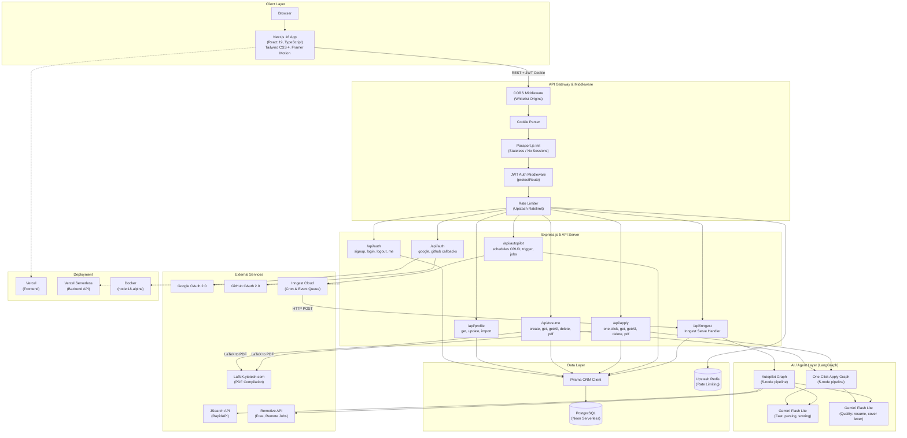
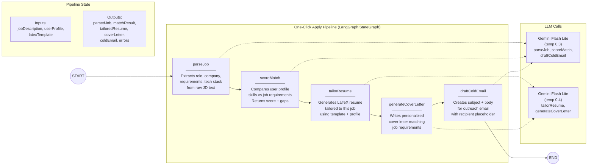
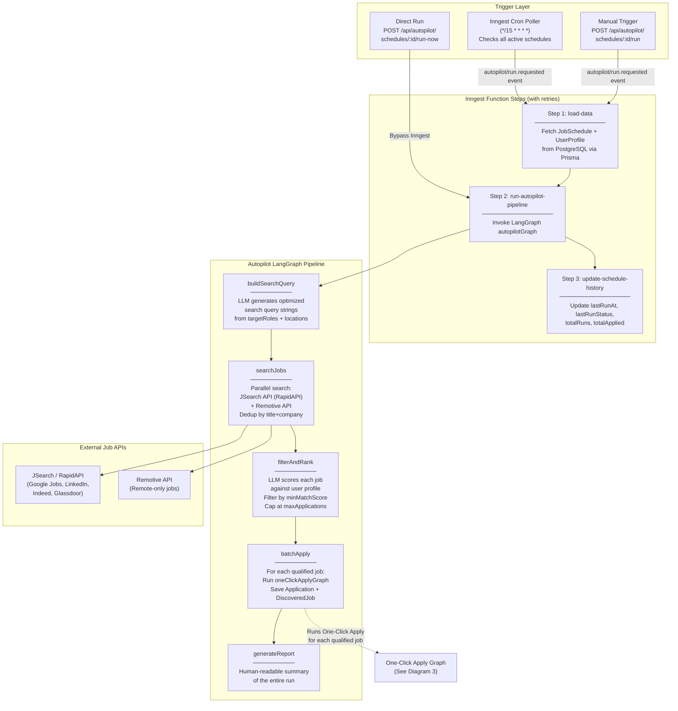
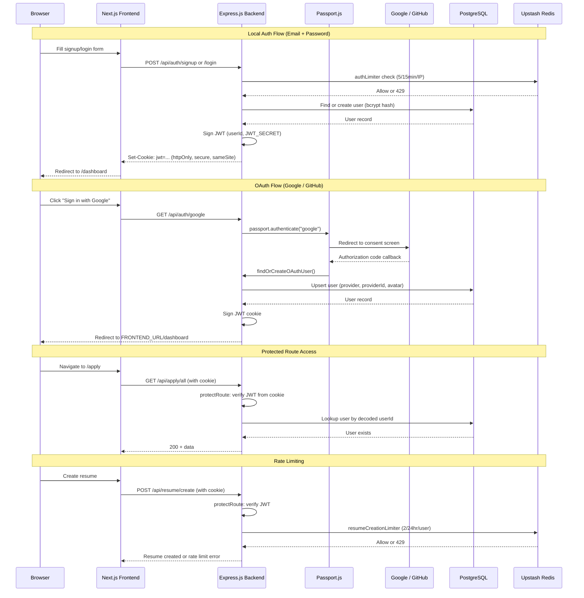
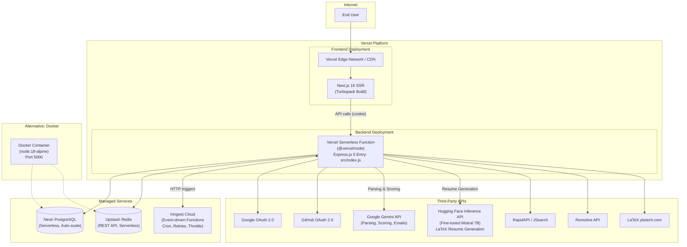
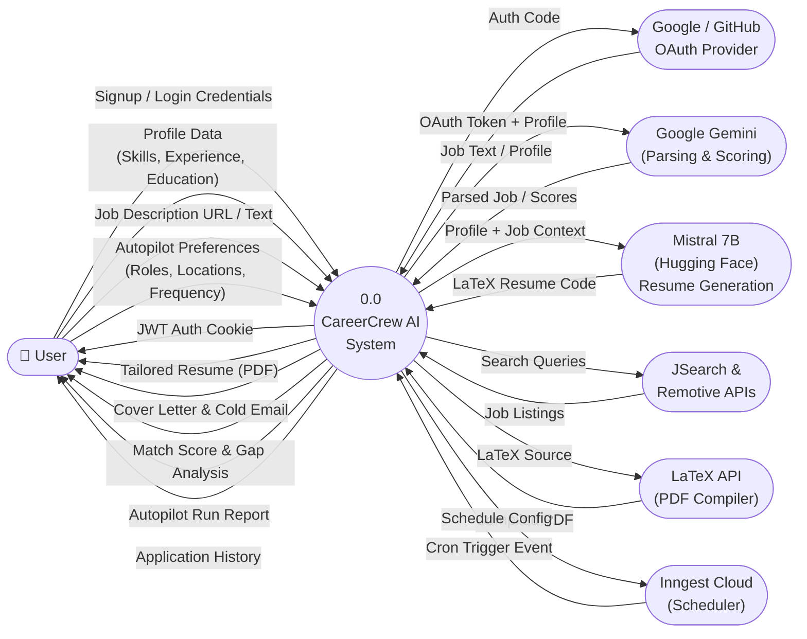
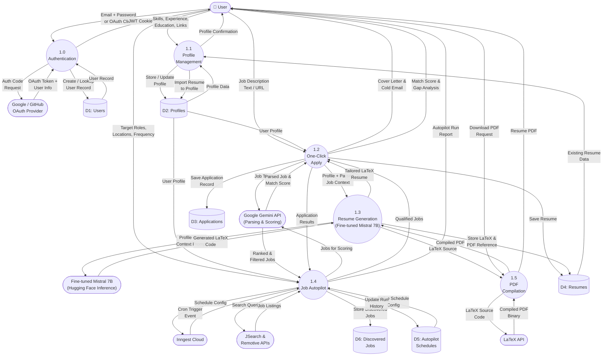

# System Architecture — CareerCrew AI

---

## 1. High-Level System Architecture

---

## 2. Backend API — Route & Controller Detail

```mermaid
flowchart LR
    subgraph AuthModule ["Auth Module"]
        direction TB
        A1["POST /api/auth/signup"]
        A2["POST /api/auth/login"]
        A3["POST /api/auth/logout"]
        A4["GET /api/auth/me"]
        A5["PUT /api/auth/updateProfile"]
        A6["GET /api/auth/google"]
        A7["GET /api/auth/google/callback"]
        A8["GET /api/auth/github"]
        A9["GET /api/auth/github/callback"]
    end

    subgraph ProfileModule ["Profile Module"]
        direction TB
        P1["GET /api/profile"]
        P2["POST /api/profile"]
        P3["POST /api/profile/import/:resumeId"]
    end

    subgraph ResumeModule ["Resume Module"]
        direction TB
        R1["POST /api/resume/create"]
        R2["GET /api/resume/all"]
        R3["GET /api/resume/:id"]
        R4["GET /api/resume/:id/pdf"]
        R5["DELETE /api/resume/:id"]
    end

    subgraph ApplyModule ["Apply Module"]
        direction TB
        AP1["POST /api/apply/one-click"]
        AP2["GET /api/apply/all"]
        AP3["GET /api/apply/:id"]
        AP4["GET /api/apply/:id/pdf"]
        AP5["DELETE /api/apply/:id"]
    end

    subgraph AutopilotModule ["Autopilot Module"]
        direction TB
        AU1["POST /api/autopilot/schedules"]
        AU2["GET /api/autopilot/schedules"]
        AU3["GET /api/autopilot/schedules/:id"]
        AU4["PATCH /api/autopilot/schedules/:id"]
        AU5["PATCH /api/autopilot/schedules/:id/toggle"]
        AU6["DELETE /api/autopilot/schedules/:id"]
        AU7["POST /api/autopilot/schedules/:id/run"]
        AU8["POST /api/autopilot/schedules/:id/run-now"]
        AU9["GET /api/autopilot/jobs"]
        AU10["DELETE /api/autopilot/jobs/:id"]
    end

    subgraph Middleware ["Middleware Stack"]
        MW1["authLimiter<br/>(5 req / 15 min / IP)"]
        MW2["resumeCreationLimiter<br/>(2 req / 24 hr / user)"]
        MW3["protectRoute<br/>(JWT cookie verify)"]
    end

    MW1 --> A1 & A2
    MW3 --> A3 & A4 & A5
    MW3 --> P1 & P2 & P3
    MW3 --> R2 & R3 & R4 & R5
    MW2 --> R1
    MW3 --> AP1 & AP2 & AP3 & AP4 & AP5
    MW3 --> AU1 & AU2 & AU3 & AU4 & AU5 & AU6 & AU7 & AU8 & AU9 & AU10
```

---

## 3. One-Click Apply — LangGraph Pipeline

---

## 4. Job Autopilot — LangGraph Pipeline + Inngest Orchestration

---

## 5. Authentication & Security Flow

---

## 6. Deployment Architecture

---

## Technology Stack Summary

| Layer | Technology | Purpose |
|---|---|---|
| **Frontend** | Next.js 16, React 19, TypeScript | SSR, routing, UI |
| **Styling** | Tailwind CSS 4, Framer Motion | Design system, animations |
| **UI Components** | Radix UI, Lucide, Tabler Icons | Accessible component primitives |
| **Backend** | Express.js 5, Node.js | REST API server |
| **AI Framework** | LangChain + LangGraph | Stateful multi-step AI pipelines |
| **LLM** | Google Gemini Flash Lite | Job parsing, resume tailoring, scoring |
| **Database** | PostgreSQL (Neon Serverless) | Primary data store |
| **ORM** | Prisma | Type-safe DB queries + migrations |
| **Cache / Rate Limit** | Upstash Redis | Sliding-window rate limiting |
| **Auth** | Passport.js, JWT (httpOnly cookies) | Local + OAuth (Google, GitHub) |
| **Background Jobs** | Inngest | Cron polling, event-driven functions, retries |
| **Job Search** | JSearch (RapidAPI), Remotive | Multi-source job aggregation |
| **PDF Compilation** | LaTeX.ytotech.com | Server-side LaTeX to PDF |
| **Deployment** | Vercel (FE + BE), Docker alt | Serverless hosting |
| **Validation** | Zod | Runtime schema validation |

---

## Key Design Decisions

1. **Stateless Auth**: JWT stored in httpOnly, secure, sameSite cookies. No server-side sessions. Passport.js used only for OAuth handshake, not session management.

2. **LangGraph Pipelines**: Both the One-Click Apply and Autopilot flows are modeled as linear `StateGraph` DAGs. Each node is a pure function that reads from and writes to an `Annotation`-based state. This makes the AI logic testable and composable.

3. **Inngest for Background Jobs**: Rather than registering a dynamic cron per user, a single poller runs every 15 minutes and checks which schedules are due. This avoids the complexity of managing per-user cron registrations. Each triggered run is retried up to 3 times and throttled to 2 concurrent runs per minute.

4. **Dual Job Sources**: JSearch (via RapidAPI) aggregates Google Jobs, LinkedIn, Indeed, and Glassdoor. Remotive supplements with remote-only positions. Results are deduplicated by `title + company`.

5. **Rate Limiting with Fail-Open**: Upstash Redis-backed sliding window limiter. If Redis is unreachable, requests are allowed through (fail-open) to avoid blocking users due to infrastructure issues.

6. **LaTeX PDF Pipeline**: Resume LaTeX code is stored in the database. PDF compilation is offloaded to an external API (`latex.ytotech.com`) to avoid needing a local TeX installation on serverless infrastructure.

---

## 7. Data Flow Diagram — Level 0 (Context Diagram)

---

## 8. Data Flow Diagram — Level 1 (Detailed)

